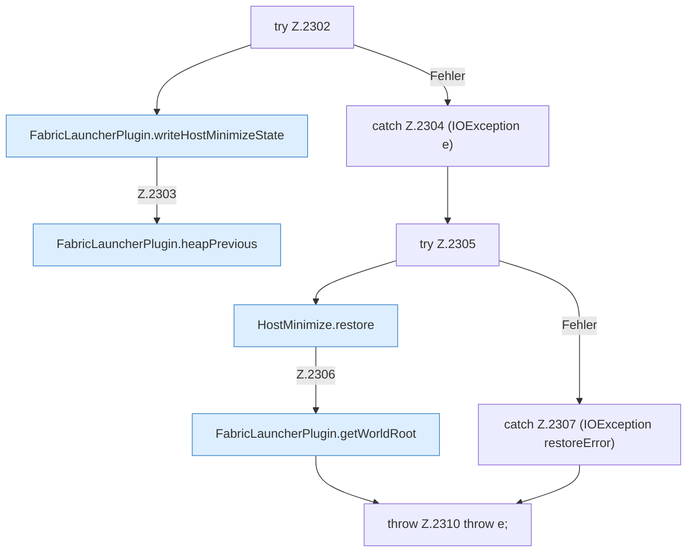

[[00 Start]] › [[Host-Betrieb]] › [[Host-Minimieren]] › [[Host-Minimieren.Teil1]] › [[FabricLauncherPlugin.hostMinimizeApply]] › [[FabricLauncherPlugin.hostMinimizeApply.Teil2.Z2302]]

# FabricLauncherPlugin.hostMinimizeApply.Teil2.Z2302



```knoten
try Z.2302
  Zeile 2302: Versuch. Der Fehlerpfad geht in catch.
FabricLauncherPlugin.writeHostMinimizeState
  Das [[Glossar#Plugin|Plugin]] schreibt den [[Glossar#Host|Host]] das Verkleinern den Zustand. Schreibt `writeHostMinimizeState`. Ruft `hostMinimizeStateFile`, `stateText`.
FabricLauncherPlugin.heapPrevious
  Das [[Glossar#Plugin|Plugin]] macht hier einen einzelnen Schritt. Eine Ebene tiefer steht er genauer. Betrifft den Heap `heapPrevious`.
catch Z.2304 (IOException e)
  Zeile 2304: fängt (IOException e).
try Z.2305
  Zeile 2305: Versuch. Der Fehlerpfad geht in catch.
HostMinimize.restore
  Das Verkleinern des [[Glossar#Host|Host]] stellt wieder her das. Stellt wieder her `restore`. Ruft `assertEditable`.
FabricLauncherPlugin.getWorldRoot
  Das [[Glossar#Plugin|Plugin]] liefert die [[Glossar#Spielwelt|Spielwelt]] den Anfang. Liefert `getWorldRoot`.
catch Z.2307 (IOException restoreError)
  Zeile 2307: fängt (IOException restoreError).
throw Z.2310 throw e;
  Zeile 2310: Abbruch `throw e;`.
```

> [!knoten]- Was die Blöcke tun
> - **try Z.2302**: Zeile 2302: Versuch. Der Fehlerpfad geht in catch.
> - **FabricLauncherPlugin.writeHostMinimizeState**: Das [[Glossar#Plugin|Plugin]] schreibt den [[Glossar#Host|Host]] das Verkleinern den Zustand. Schreibt `writeHostMinimizeState`. Ruft `hostMinimizeStateFile`, `stateText`.
> - **FabricLauncherPlugin.heapPrevious**: Das [[Glossar#Plugin|Plugin]] macht hier einen einzelnen Schritt. Eine Ebene tiefer steht er genauer. Betrifft den Heap `heapPrevious`.
> - **catch Z.2304 (IOException e)**: Zeile 2304: fängt (IOException e).
> - **try Z.2305**: Zeile 2305: Versuch. Der Fehlerpfad geht in catch.
> - **HostMinimize.restore**: Das Verkleinern des [[Glossar#Host|Host]] stellt wieder her das. Stellt wieder her `restore`. Ruft `assertEditable`.
> - **FabricLauncherPlugin.getWorldRoot**: Das [[Glossar#Plugin|Plugin]] liefert die [[Glossar#Spielwelt|Spielwelt]] den Anfang. Liefert `getWorldRoot`.
> - **catch Z.2307 (IOException restoreError)**: Zeile 2307: fängt (IOException restoreError).
> - **throw Z.2310 throw e;**: Zeile 2310: Abbruch `throw e;`.

- Der Ablauf geht in [[Glossar#Zeile|Zeile]] 2302 weiter. Eine Ebene tiefer steht er genauer.
- Fortsetzung von `FabricLauncherPlugin.hostMinimizeApply.Teil2`.
