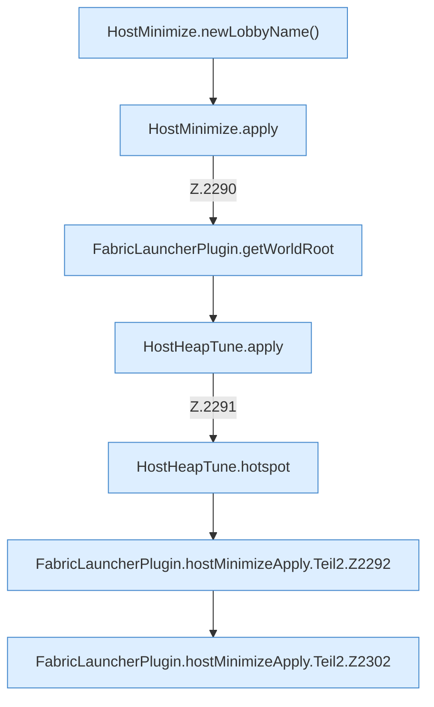

[[00 Start]] › [[Host-Betrieb]] › [[Host-Minimieren]] › [[Host-Minimieren.Teil1]] › [[FabricLauncherPlugin.hostMinimizeApply]] › [[FabricLauncherPlugin.hostMinimizeApply.Teil2]]

# FabricLauncherPlugin.hostMinimizeApply.Teil2



```knoten
HostMinimize.newLobbyName()
  Das Verkleinern des [[Glossar#Host|Host]] kümmert sich um die Wartewelt den Namen. `newLobbyName` in `HostMinimize.java`.
HostMinimize.apply
  Das Verkleinern des [[Glossar#Host|Host]] wendet an das. Wendet an `apply`. Ruft `assertRoot`, `assertEditable`, `update`.
FabricLauncherPlugin.getWorldRoot
  Das [[Glossar#Plugin|Plugin]] liefert die [[Glossar#Spielwelt|Spielwelt]] den Anfang. Liefert `getWorldRoot`.
HostHeapTune.apply
  Dieser Teil wendet an das. Wendet an `apply`.
HostHeapTune.hotspot
  Dieser Teil macht hier einen einzelnen Schritt. Eine Ebene tiefer steht er genauer. `hotspot` in `HostHeapTune.java`. Ruft `manageable`, `get`, `set`.
FabricLauncherPlugin.hostMinimizeApply.Teil2.Z2292
  Der Ablauf geht in [[Glossar#Zeile|Zeile]] 2292 weiter. Eine Ebene tiefer steht er genauer. Fortsetzung des Ablaufs ab Zeile 2292.
FabricLauncherPlugin.hostMinimizeApply.Teil2.Z2302
  Der Ablauf geht in [[Glossar#Zeile|Zeile]] 2302 weiter. Eine Ebene tiefer steht er genauer. Fortsetzung des Ablaufs ab Zeile 2302.
```

> [!knoten]- Was die Blöcke tun
> - **HostMinimize.newLobbyName()**: Das Verkleinern des [[Glossar#Host|Host]] kümmert sich um die Wartewelt den Namen. `newLobbyName` in `HostMinimize.java`.
> - **HostMinimize.apply**: Das Verkleinern des [[Glossar#Host|Host]] wendet an das. Wendet an `apply`. Ruft `assertRoot`, `assertEditable`, `update`.
> - **FabricLauncherPlugin.getWorldRoot**: Das [[Glossar#Plugin|Plugin]] liefert die [[Glossar#Spielwelt|Spielwelt]] den Anfang. Liefert `getWorldRoot`.
> - **HostHeapTune.apply**: Dieser Teil wendet an das. Wendet an `apply`.
> - **HostHeapTune.hotspot**: Dieser Teil macht hier einen einzelnen Schritt. Eine Ebene tiefer steht er genauer. `hotspot` in `HostHeapTune.java`. Ruft `manageable`, `get`, `set`.
> - **FabricLauncherPlugin.hostMinimizeApply.Teil2.Z2292**: Der Ablauf geht in [[Glossar#Zeile|Zeile]] 2292 weiter. Eine Ebene tiefer steht er genauer. Fortsetzung des Ablaufs ab Zeile 2292.
> - **FabricLauncherPlugin.hostMinimizeApply.Teil2.Z2302**: Der Ablauf geht in [[Glossar#Zeile|Zeile]] 2302 weiter. Eine Ebene tiefer steht er genauer. Fortsetzung des Ablaufs ab Zeile 2302.

- Ein weiterer Abschnitt derselben Übersicht.
- Fortsetzung von `FabricLauncherPlugin.hostMinimizeApply`.
