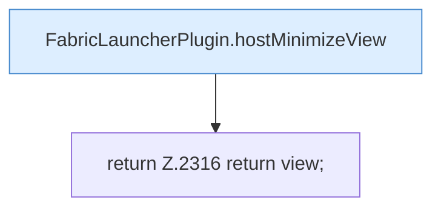

[[00 Start]] › [[Host-Betrieb]] › [[Host-Minimieren]] › [[Host-Minimieren.Teil1]] › [[FabricLauncherPlugin.hostMinimizeApply]] › [[FabricLauncherPlugin.hostMinimizeApply.Teil3]]

# FabricLauncherPlugin.hostMinimizeApply.Teil3

- Fortsetzung von `FabricLauncherPlugin.hostMinimizeApply`, Quellreihenfolge.
