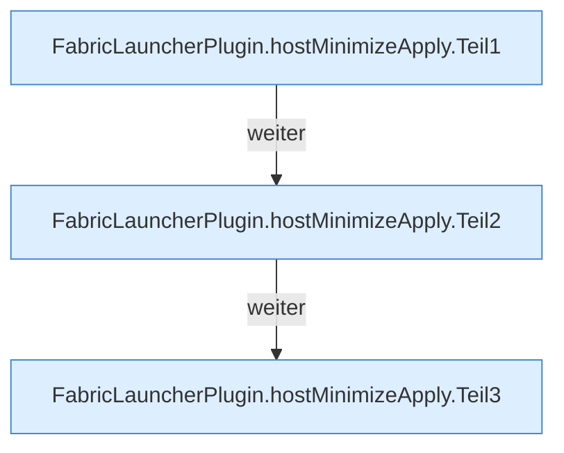

[[00 Start]] › [[Host-Betrieb]] › [[Host-Minimieren]] › [[Host-Minimieren.Teil1]] › [[FabricLauncherPlugin.hostMinimizeApply]]

# FabricLauncherPlugin.hostMinimizeApply

`FabricLauncherPlugin.hostMinimizeApply(String confirm)` [src/main/java/de/aichele/childlauncher/FabricLauncherPlugin.java:2270–2317](https://github.com/Sciddie/minecraft-serverhoster-plugin/blob/95b02b953b0b4c23673e900e021a7c3c844aa37d/src/main/java/de/aichele/childlauncher/FabricLauncherPlugin.java#L2270-L2317)



```knoten
FabricLauncherPlugin.hostMinimizeApply.Teil1
  Ein weiterer Abschnitt derselben Übersicht. Abschnitt 1 dieses Ablaufs, in Quellreihenfolge.
FabricLauncherPlugin.hostMinimizeApply.Teil2
  Ein weiterer Abschnitt derselben Übersicht. Abschnitt 2 dieses Ablaufs, in Quellreihenfolge.
FabricLauncherPlugin.hostMinimizeApply.Teil3
  Ein weiterer Abschnitt derselben Übersicht. Abschnitt 3 dieses Ablaufs, in Quellreihenfolge.
```

> [!knoten]- Was die Blöcke tun
> - **FabricLauncherPlugin.hostMinimizeApply.Teil1**: Ein weiterer Abschnitt derselben Übersicht. Abschnitt 1 dieses Ablaufs, in Quellreihenfolge.
> - **FabricLauncherPlugin.hostMinimizeApply.Teil2**: Ein weiterer Abschnitt derselben Übersicht. Abschnitt 2 dieses Ablaufs, in Quellreihenfolge.
> - **FabricLauncherPlugin.hostMinimizeApply.Teil3**: Ein weiterer Abschnitt derselben Übersicht. Abschnitt 3 dieses Ablaufs, in Quellreihenfolge.

- Das [[Glossar#Plugin|Plugin]] kümmert sich um das Verkleinern das Anwenden.
- `hostMinimizeApply` in `src/main/java/de/aichele/childlauncher/FabricLauncherPlugin.java`
