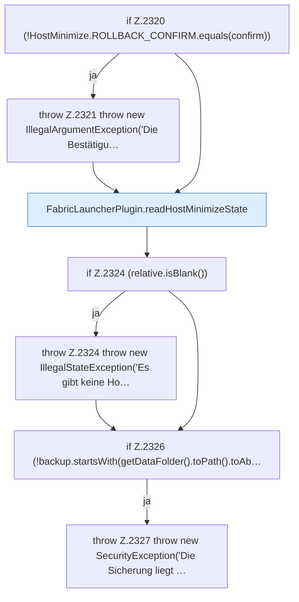

[[00 Start]] › [[Host-Betrieb]] › [[Host-Minimieren]] › [[Host-Minimieren.Teil1]] › [[FabricLauncherPlugin.hostMinimizeRollback]] › [[FabricLauncherPlugin.hostMinimizeRollback.Teil1]]

# FabricLauncherPlugin.hostMinimizeRollback.Teil1

- Fortsetzung von `FabricLauncherPlugin.hostMinimizeRollback`, Quellreihenfolge.
