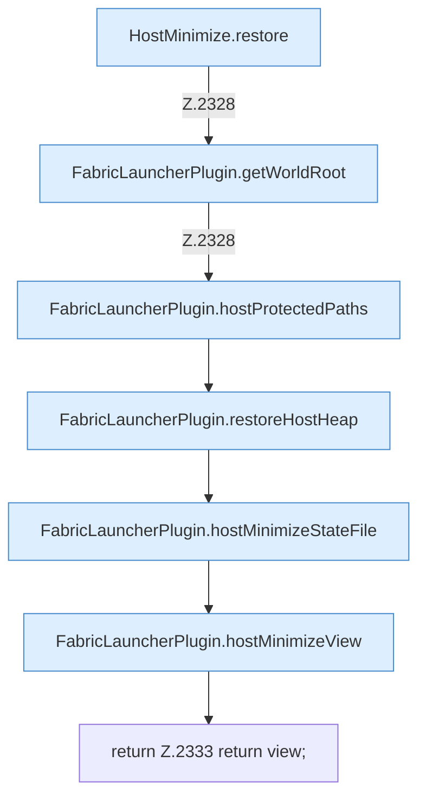

[[00 Start]] › [[Host-Betrieb]] › [[Host-Minimieren]] › [[Host-Minimieren.Teil1]] › [[FabricLauncherPlugin.hostMinimizeRollback]] › [[FabricLauncherPlugin.hostMinimizeRollback.Teil2]]

# FabricLauncherPlugin.hostMinimizeRollback.Teil2



```knoten
HostMinimize.restore
  Das Verkleinern des [[Glossar#Host|Host]] stellt wieder her das. Stellt wieder her `restore`. Ruft `assertEditable`.
FabricLauncherPlugin.getWorldRoot
  Das [[Glossar#Plugin|Plugin]] liefert die [[Glossar#Spielwelt|Spielwelt]] den Anfang. Liefert `getWorldRoot`.
FabricLauncherPlugin.hostProtectedPaths
  Die Ordner des [[Glossar#Host|Host]], die nicht gelöscht oder überschrieben werden dürfen. Betrifft den Host `hostProtectedPaths`. Ruft `getWorldRoot`, `directory`.
FabricLauncherPlugin.restoreHostHeap
  Das [[Glossar#Plugin|Plugin]] stellt wieder her den [[Glossar#Host|Host]] den Programmspeicher. Stellt wieder her `restoreHostHeap`. Ruft `hotspot`.
FabricLauncherPlugin.hostMinimizeStateFile
  Das [[Glossar#Plugin|Plugin]] kümmert sich um das Verkleinern den Zustand die Datei. Betrifft den [[Glossar#Host|Host]] `hostMinimizeStateFile`.
FabricLauncherPlugin.hostMinimizeView
  Das [[Glossar#Plugin|Plugin]] kümmert sich um das Verkleinern die Ansicht. Betrifft den [[Glossar#Host|Host]] `hostMinimizeView`. Ruft `readHostMinimizeState`, `configuredHostWorld`, `preview`.
return Z.2333 return view;
  Zeile 2333: Rückgabe `return view;`.
```

> [!knoten]- Was die Blöcke tun
> - **HostMinimize.restore**: Das Verkleinern des [[Glossar#Host|Host]] stellt wieder her das. Stellt wieder her `restore`. Ruft `assertEditable`.
> - **FabricLauncherPlugin.getWorldRoot**: Das [[Glossar#Plugin|Plugin]] liefert die [[Glossar#Spielwelt|Spielwelt]] den Anfang. Liefert `getWorldRoot`.
> - **FabricLauncherPlugin.hostProtectedPaths**: Die Ordner des [[Glossar#Host|Host]], die nicht gelöscht oder überschrieben werden dürfen. Betrifft den Host `hostProtectedPaths`. Ruft `getWorldRoot`, `directory`.
> - **FabricLauncherPlugin.restoreHostHeap**: Das [[Glossar#Plugin|Plugin]] stellt wieder her den [[Glossar#Host|Host]] den Programmspeicher. Stellt wieder her `restoreHostHeap`. Ruft `hotspot`.
> - **FabricLauncherPlugin.hostMinimizeStateFile**: Das [[Glossar#Plugin|Plugin]] kümmert sich um das Verkleinern den Zustand die Datei. Betrifft den [[Glossar#Host|Host]] `hostMinimizeStateFile`.
> - **FabricLauncherPlugin.hostMinimizeView**: Das [[Glossar#Plugin|Plugin]] kümmert sich um das Verkleinern die Ansicht. Betrifft den [[Glossar#Host|Host]] `hostMinimizeView`. Ruft `readHostMinimizeState`, `configuredHostWorld`, `preview`.
> - **return Z.2333 return view;**: Zeile 2333: Rückgabe `return view;`.

- Ein weiterer Abschnitt derselben Übersicht.
- Fortsetzung von `FabricLauncherPlugin.hostMinimizeRollback`.
