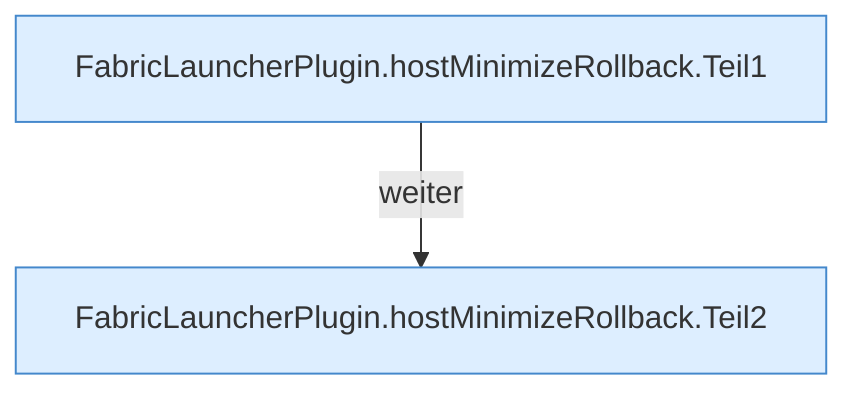

[[00 Start]] › [[Host-Betrieb]] › [[Host-Minimieren]] › [[Host-Minimieren.Teil1]] › [[FabricLauncherPlugin.hostMinimizeRollback]]

# FabricLauncherPlugin.hostMinimizeRollback

`FabricLauncherPlugin.hostMinimizeRollback(String confirm)` [src/main/java/de/aichele/childlauncher/FabricLauncherPlugin.java:2319–2334](https://github.com/Sciddie/minecraft-serverhoster-plugin/blob/95b02b953b0b4c23673e900e021a7c3c844aa37d/src/main/java/de/aichele/childlauncher/FabricLauncherPlugin.java#L2319-L2334)

- `hostMinimizeRollback` in `src/main/java/de/aichele/childlauncher/FabricLauncherPlugin.java`
