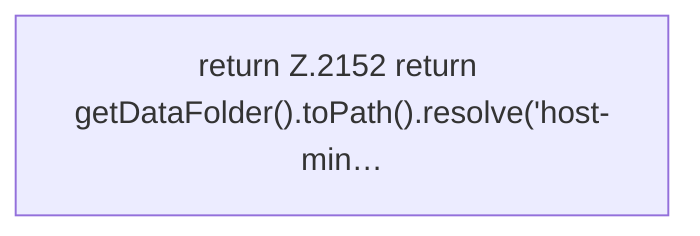

[[00 Start]] › [[Host-Betrieb]] › [[Host-Minimieren]] › [[Host-Minimieren.Teil1]] › [[FabricLauncherPlugin.hostMinimizeStateFile]]

# FabricLauncherPlugin.hostMinimizeStateFile

`FabricLauncherPlugin.hostMinimizeStateFile()` [src/main/java/de/aichele/childlauncher/FabricLauncherPlugin.java:2151–2153](https://github.com/Sciddie/minecraft-serverhoster-plugin/blob/95b02b953b0b4c23673e900e021a7c3c844aa37d/src/main/java/de/aichele/childlauncher/FabricLauncherPlugin.java#L2151-L2153)



```knoten
return Z.2152 return getDataFolder().toPath().resolve('host-min…
  Zeile 2152: Rückgabe `return getDataFolder().toPath().resolve('host-min…`.
```

- `hostMinimizeStateFile` in `src/main/java/de/aichele/childlauncher/FabricLauncherPlugin.java`
