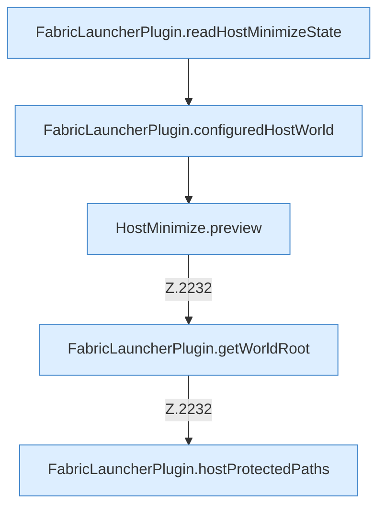

[[00 Start]] › [[Host-Betrieb]] › [[Host-Minimieren]] › [[Host-Minimieren.Teil1]] › [[FabricLauncherPlugin.hostMinimizeView]] › [[FabricLauncherPlugin.hostMinimizeView.Teil1]]

# FabricLauncherPlugin.hostMinimizeView.Teil1

- Fortsetzung von `FabricLauncherPlugin.hostMinimizeView`, Quellreihenfolge.
