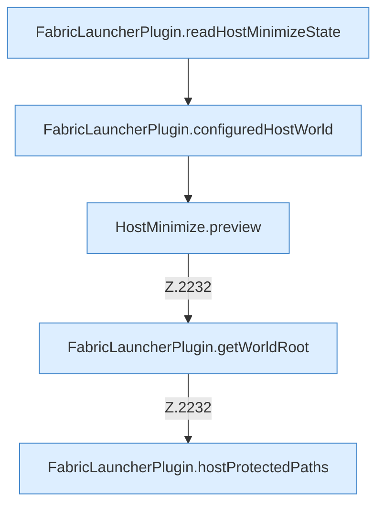

[[00 Start]] › [[Host-Betrieb]] › [[Host-Minimieren]] › [[Host-Minimieren.Teil1]] › [[FabricLauncherPlugin.hostMinimizeView]] › [[FabricLauncherPlugin.hostMinimizeView.Teil1]]

# FabricLauncherPlugin.hostMinimizeView.Teil1



```knoten
FabricLauncherPlugin.readHostMinimizeState
  Das [[Glossar#Plugin|Plugin]] liest den [[Glossar#Host|Host]] das Verkleinern den Zustand. Liest `readHostMinimizeState`. Ruft `hostMinimizeStateFile`, `readState`.
FabricLauncherPlugin.configuredHostWorld
  Liest, welche [[Glossar#Spielwelt|Spielwelt]] der [[Glossar#Host|Host]] benutzen soll. Liest den konfigurierten Wert `configuredHostWorld`. Ruft `getWorldRoot`, `worldNameSafe`.
HostMinimize.preview
  Das Verkleinern des [[Glossar#Host|Host]] macht hier einen einzelnen Schritt. Eine Ebene tiefer steht er genauer. Zeigt die Vorschau `preview`. Ruft `assertRoot`, `readProperties`, `outerProperties`.
FabricLauncherPlugin.getWorldRoot
  Das [[Glossar#Plugin|Plugin]] liefert die [[Glossar#Spielwelt|Spielwelt]] den Anfang. Liefert `getWorldRoot`.
FabricLauncherPlugin.hostProtectedPaths
  Die Ordner des [[Glossar#Host|Host]], die nicht gelöscht oder überschrieben werden dürfen. Betrifft den Host `hostProtectedPaths`. Ruft `getWorldRoot`, `directory`.
```

> [!knoten]- Was die Blöcke tun
> - **FabricLauncherPlugin.readHostMinimizeState**: Das [[Glossar#Plugin|Plugin]] liest den [[Glossar#Host|Host]] das Verkleinern den Zustand. Liest `readHostMinimizeState`. Ruft `hostMinimizeStateFile`, `readState`.
> - **FabricLauncherPlugin.configuredHostWorld**: Liest, welche [[Glossar#Spielwelt|Spielwelt]] der [[Glossar#Host|Host]] benutzen soll. Liest den konfigurierten Wert `configuredHostWorld`. Ruft `getWorldRoot`, `worldNameSafe`.
> - **HostMinimize.preview**: Das Verkleinern des [[Glossar#Host|Host]] macht hier einen einzelnen Schritt. Eine Ebene tiefer steht er genauer. Zeigt die Vorschau `preview`. Ruft `assertRoot`, `readProperties`, `outerProperties`.
> - **FabricLauncherPlugin.getWorldRoot**: Das [[Glossar#Plugin|Plugin]] liefert die [[Glossar#Spielwelt|Spielwelt]] den Anfang. Liefert `getWorldRoot`.
> - **FabricLauncherPlugin.hostProtectedPaths**: Die Ordner des [[Glossar#Host|Host]], die nicht gelöscht oder überschrieben werden dürfen. Betrifft den Host `hostProtectedPaths`. Ruft `getWorldRoot`, `directory`.

- Ein weiterer Abschnitt derselben Übersicht.
- Fortsetzung von `FabricLauncherPlugin.hostMinimizeView`.
