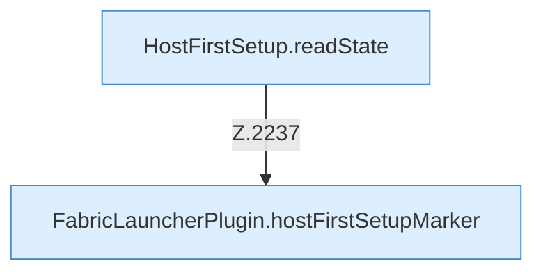

[[00 Start]] › [[Host-Betrieb]] › [[Host-Minimieren]] › [[Host-Minimieren.Teil1]] › [[FabricLauncherPlugin.hostMinimizeView]] › [[FabricLauncherPlugin.hostMinimizeView.Teil2]]

# FabricLauncherPlugin.hostMinimizeView.Teil2



```knoten
HostFirstSetup.readState
  Die [[Glossar#Ersteinrichtung|Ersteinrichtung]] liest den Zustand. Liest `readState`. Ruft `readState`.
FabricLauncherPlugin.hostFirstSetupMarker
  Liest oder schreibt die Merkdatei der [[Glossar#Ersteinrichtung|Ersteinrichtung]]. Betrifft den [[Glossar#Host|Host]] `hostFirstSetupMarker`.
```

> [!knoten]- Was die Blöcke tun
> - **HostFirstSetup.readState**: Die [[Glossar#Ersteinrichtung|Ersteinrichtung]] liest den Zustand. Liest `readState`. Ruft `readState`.
> - **FabricLauncherPlugin.hostFirstSetupMarker**: Liest oder schreibt die Merkdatei der [[Glossar#Ersteinrichtung|Ersteinrichtung]]. Betrifft den [[Glossar#Host|Host]] `hostFirstSetupMarker`.

- Ein weiterer Abschnitt derselben Übersicht.
- Fortsetzung von `FabricLauncherPlugin.hostMinimizeView`.
