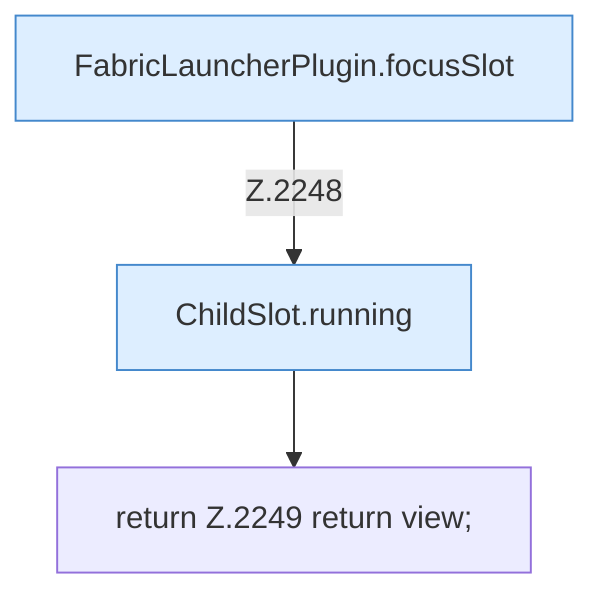

[[00 Start]] › [[Host-Betrieb]] › [[Host-Minimieren]] › [[Host-Minimieren.Teil1]] › [[FabricLauncherPlugin.hostMinimizeView]] › [[FabricLauncherPlugin.hostMinimizeView.Teil3]]

# FabricLauncherPlugin.hostMinimizeView.Teil3



```knoten
FabricLauncherPlugin.focusSlot
  Das [[Glossar#Plugin|Plugin]] liefert den [[Glossar#Platz|Platz]]. Liefert oder setzt den [[Glossar#Fokus|Fokus]] `focusSlot`. Ruft `slot`.
ChildSlot.running
  Dieser Teil prüft, ob läuft, das. Sagt, ob der [[Glossar#Prozess|Prozess]] läuft `running`.
return Z.2249 return view;
  Zeile 2249: Rückgabe `return view;`.
```

> [!knoten]- Was die Blöcke tun
> - **FabricLauncherPlugin.focusSlot**: Das [[Glossar#Plugin|Plugin]] liefert den [[Glossar#Platz|Platz]]. Liefert oder setzt den [[Glossar#Fokus|Fokus]] `focusSlot`. Ruft `slot`.
> - **ChildSlot.running**: Dieser Teil prüft, ob läuft, das. Sagt, ob der [[Glossar#Prozess|Prozess]] läuft `running`.
> - **return Z.2249 return view;**: Zeile 2249: Rückgabe `return view;`.

- Ein weiterer Abschnitt derselben Übersicht.
- Fortsetzung von `FabricLauncherPlugin.hostMinimizeView`.
