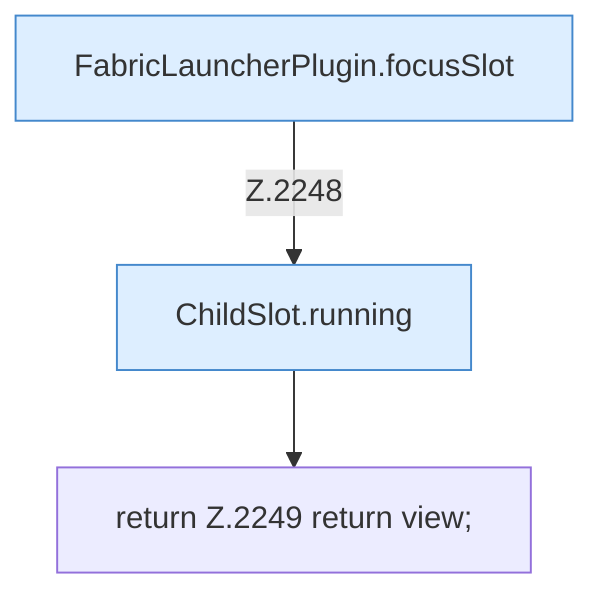

[[00 Start]] › [[Host-Betrieb]] › [[Host-Minimieren]] › [[Host-Minimieren.Teil1]] › [[FabricLauncherPlugin.hostMinimizeView]] › [[FabricLauncherPlugin.hostMinimizeView.Teil3]]

# FabricLauncherPlugin.hostMinimizeView.Teil3



```knoten
FabricLauncherPlugin.focusSlot
  Liefert oder setzt den Fokus `focusSlot`. Ruft `slot`.
ChildSlot.running
  Sagt, ob der Prozess läuft `running`.
return Z.2249 return view;
  Zeile 2249: Rückgabe `return view;`.
```

- Fortsetzung von `FabricLauncherPlugin.hostMinimizeView`, Quellreihenfolge.
