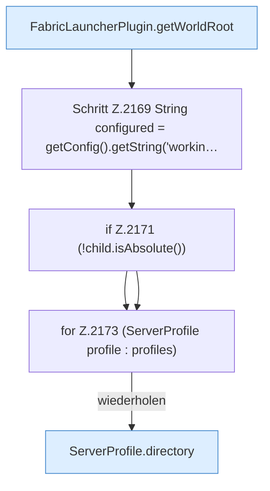

[[00 Start]] › [[Plugin-Kern]] › [[Host-Pfade]] › [[FabricLauncherPlugin.hostProtectedPaths]] › [[FabricLauncherPlugin.hostProtectedPaths.Teil1]]

# FabricLauncherPlugin.hostProtectedPaths.Teil1



```knoten
FabricLauncherPlugin.getWorldRoot
  Das [[Glossar#Plugin|Plugin]] liefert die [[Glossar#Spielwelt|Spielwelt]] den Anfang. Liefert `getWorldRoot`.
Schritt Z.2169 String configured = getConfig().getString('workin…
  Zeile 2169: liest die Config. `String configured = getConfig().getString('workin…`
if Z.2171 (!child.isAbsolute())
  Zeile 2171: prüft `(!child.isAbsolute())`.
for Z.2173 (ServerProfile profile : profiles)
  Zeile 2173: Schleife `(ServerProfile profile : profiles)`.
ServerProfile.directory
  Die Serverbeschreibung macht hier einen einzelnen Schritt. Eine Ebene tiefer steht er genauer. `directory` in `ServerProfile.java`.
```

> [!knoten]- Was die Blöcke tun
> - **FabricLauncherPlugin.getWorldRoot**: Das [[Glossar#Plugin|Plugin]] liefert die [[Glossar#Spielwelt|Spielwelt]] den Anfang. Liefert `getWorldRoot`.
> - **Schritt Z.2169 String configured = getConfig().getString('workin…**: Zeile 2169: liest die Config. `String configured = getConfig().getString('workin…`
> - **if Z.2171 (!child.isAbsolute())**: Zeile 2171: prüft `(!child.isAbsolute())`.
> - **for Z.2173 (ServerProfile profile : profiles)**: Zeile 2173: Schleife `(ServerProfile profile : profiles)`.
> - **ServerProfile.directory**: Die Serverbeschreibung macht hier einen einzelnen Schritt. Eine Ebene tiefer steht er genauer. `directory` in `ServerProfile.java`.

- Ein weiterer Abschnitt derselben Übersicht.
- Fortsetzung von `FabricLauncherPlugin.hostProtectedPaths`.
