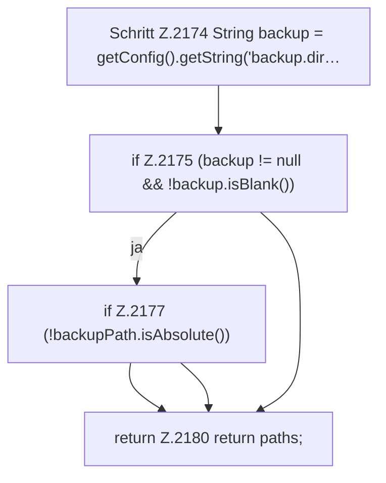

[[00 Start]] › [[Plugin-Kern]] › [[Host-Pfade]] › [[FabricLauncherPlugin.hostProtectedPaths]] › [[FabricLauncherPlugin.hostProtectedPaths.Teil2]]

# FabricLauncherPlugin.hostProtectedPaths.Teil2

- Fortsetzung von `FabricLauncherPlugin.hostProtectedPaths`, Quellreihenfolge.
