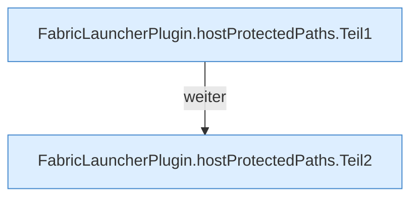

[[00 Start]] › [[Plugin-Kern]] › [[Host-Pfade]] › [[FabricLauncherPlugin.hostProtectedPaths]]

# FabricLauncherPlugin.hostProtectedPaths

`FabricLauncherPlugin.hostProtectedPaths()` [src/main/java/de/aichele/childlauncher/FabricLauncherPlugin.java:2165–2181](https://github.com/Sciddie/minecraft-serverhoster-plugin/blob/95b02b953b0b4c23673e900e021a7c3c844aa37d/src/main/java/de/aichele/childlauncher/FabricLauncherPlugin.java#L2165-L2181)



```knoten
FabricLauncherPlugin.hostProtectedPaths.Teil1
  Ein weiterer Abschnitt derselben Übersicht. Im [[Glossar#Quelltext|Quelltext]] heißt das `Teil1`.
FabricLauncherPlugin.hostProtectedPaths.Teil2
  Ein weiterer Abschnitt derselben Übersicht. Im [[Glossar#Quelltext|Quelltext]] heißt das `Teil2`.
```

> [!knoten]- Was die Blöcke tun
> - **FabricLauncherPlugin.hostProtectedPaths.Teil1**: Ein weiterer Abschnitt derselben Übersicht. Im [[Glossar#Quelltext|Quelltext]] heißt das `Teil1`.
> - **FabricLauncherPlugin.hostProtectedPaths.Teil2**: Ein weiterer Abschnitt derselben Übersicht. Im [[Glossar#Quelltext|Quelltext]] heißt das `Teil2`.

- Die Ordner des [[Glossar#Host|Host]], die nicht gelöscht oder überschrieben werden dürfen.
