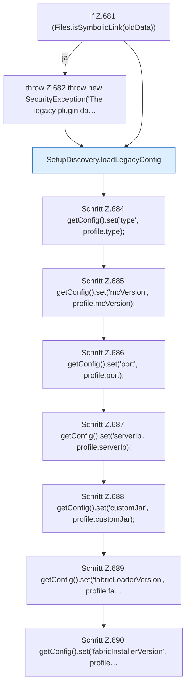

[[00 Start]] › [[Plugin-Kern]] › [[Setup]] › [[Setup-Import]] › [[FabricLauncherPlugin.importLegacyConfiguration]] › [[FabricLauncherPlugin.importLegacyConfiguration.Teil1]]

# FabricLauncherPlugin.importLegacyConfiguration.Teil1



```knoten
if Z.681 (Files.isSymbolicLink(oldData))
  Zeile 681: prüft `(Files.isSymbolicLink(oldData))`.
throw Z.682 throw new SecurityException('The legacy plugin da…
  Zeile 682: Abbruch `throw new SecurityException('The legacy plugin da…`.
SetupDiscovery.loadLegacyConfig
  Lädt `loadLegacyConfig`.
Schritt Z.684 getConfig().set('type', profile.type);
  Zeile 684: liest die Config. `getConfig().set('type', profile.type);`
Schritt Z.685 getConfig().set('mcVersion', profile.mcVersion);
  Zeile 685: liest die Config. `getConfig().set('mcVersion', profile.mcVersion);`
Schritt Z.686 getConfig().set('port', profile.port);
  Zeile 686: liest die Config. `getConfig().set('port', profile.port);`
Schritt Z.687 getConfig().set('serverIp', profile.serverIp);
  Zeile 687: liest die Config. `getConfig().set('serverIp', profile.serverIp);`
Schritt Z.688 getConfig().set('customJar', profile.customJar);
  Zeile 688: liest die Config. `getConfig().set('customJar', profile.customJar);`
Schritt Z.689 getConfig().set('fabricLoaderVersion', profile.fa…
  Zeile 689: liest die Config. `getConfig().set('fabricLoaderVersion', profile.fa…`
Schritt Z.690 getConfig().set('fabricInstallerVersion', profile…
  Zeile 690: liest die Config. `getConfig().set('fabricInstallerVersion', profile…`
```

- Fortsetzung von `FabricLauncherPlugin.importLegacyConfiguration`, Quellreihenfolge.
