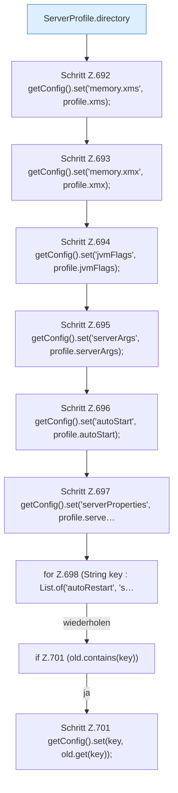

[[00 Start]] › [[Plugin-Kern]] › [[Setup]] › [[Setup-Import]] › [[FabricLauncherPlugin.importLegacyConfiguration]] › [[FabricLauncherPlugin.importLegacyConfiguration.Teil2]]

# FabricLauncherPlugin.importLegacyConfiguration.Teil2



```knoten
ServerProfile.directory
  Die Serverbeschreibung macht hier einen einzelnen Schritt. Eine Ebene tiefer steht er genauer. `directory` in `ServerProfile.java`.
Schritt Z.692 getConfig().set('memory.xms', profile.xms);
  Zeile 692: liest die Config. `getConfig().set('memory.xms', profile.xms);`
Schritt Z.693 getConfig().set('memory.xmx', profile.xmx);
  Zeile 693: liest die Config. `getConfig().set('memory.xmx', profile.xmx);`
Schritt Z.694 getConfig().set('jvmFlags', profile.jvmFlags);
  Zeile 694: liest die Config. `getConfig().set('jvmFlags', profile.jvmFlags);`
Schritt Z.695 getConfig().set('serverArgs', profile.serverArgs);
  Zeile 695: liest die Config. `getConfig().set('serverArgs', profile.serverArgs);`
Schritt Z.696 getConfig().set('autoStart', profile.autoStart);
  Zeile 696: liest die Config. `getConfig().set('autoStart', profile.autoStart);`
Schritt Z.697 getConfig().set('serverProperties', profile.serve…
  Zeile 697: liest die Config. `getConfig().set('serverProperties', profile.serve…`
for Z.698 (String key : List.of('autoRestart', 's…
  Zeile 698: Schleife `(String key : List.of('autoRestart', 's…`.
if Z.701 (old.contains(key))
  Zeile 701: prüft `(old.contains(key))`.
Schritt Z.701 getConfig().set(key, old.get(key));
  Zeile 701: liest die Config. `getConfig().set(key, old.get(key));`
```

> [!knoten]- Was die Blöcke tun
> - **ServerProfile.directory**: Die Serverbeschreibung macht hier einen einzelnen Schritt. Eine Ebene tiefer steht er genauer. `directory` in `ServerProfile.java`.
> - **Schritt Z.692 getConfig().set('memory.xms', profile.xms);**: Zeile 692: liest die Config. `getConfig().set('memory.xms', profile.xms);`
> - **Schritt Z.693 getConfig().set('memory.xmx', profile.xmx);**: Zeile 693: liest die Config. `getConfig().set('memory.xmx', profile.xmx);`
> - **Schritt Z.694 getConfig().set('jvmFlags', profile.jvmFlags);**: Zeile 694: liest die Config. `getConfig().set('jvmFlags', profile.jvmFlags);`
> - **Schritt Z.695 getConfig().set('serverArgs', profile.serverArgs);**: Zeile 695: liest die Config. `getConfig().set('serverArgs', profile.serverArgs);`
> - **Schritt Z.696 getConfig().set('autoStart', profile.autoStart);**: Zeile 696: liest die Config. `getConfig().set('autoStart', profile.autoStart);`
> - **Schritt Z.697 getConfig().set('serverProperties', profile.serve…**: Zeile 697: liest die Config. `getConfig().set('serverProperties', profile.serve…`
> - **for Z.698 (String key : List.of('autoRestart', 's…**: Zeile 698: Schleife `(String key : List.of('autoRestart', 's…`.
> - **if Z.701 (old.contains(key))**: Zeile 701: prüft `(old.contains(key))`.
> - **Schritt Z.701 getConfig().set(key, old.get(key));**: Zeile 701: liest die Config. `getConfig().set(key, old.get(key));`

- Ein weiterer Abschnitt derselben Übersicht.
- Fortsetzung von `FabricLauncherPlugin.importLegacyConfiguration`.
