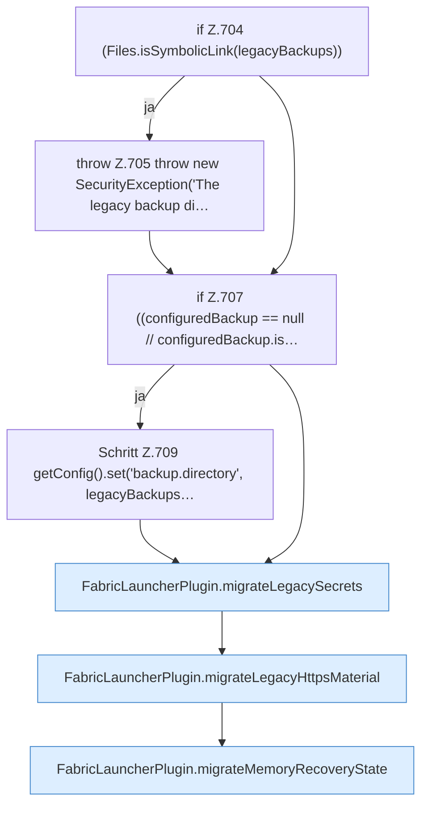

[[00 Start]] › [[Plugin-Kern]] › [[Setup]] › [[Setup-Import]] › [[FabricLauncherPlugin.importLegacyConfiguration]] › [[FabricLauncherPlugin.importLegacyConfiguration.Teil3]]

# FabricLauncherPlugin.importLegacyConfiguration.Teil3

- Fortsetzung von `FabricLauncherPlugin.importLegacyConfiguration`, Quellreihenfolge.
