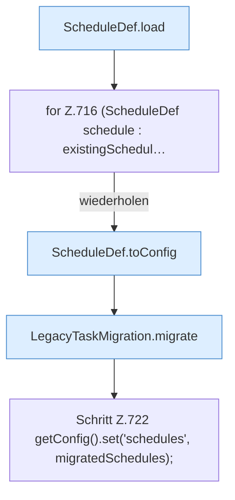

[[00 Start]] › [[Plugin-Kern]] › [[Setup]] › [[Setup-Import]] › [[FabricLauncherPlugin.importLegacyConfiguration]] › [[FabricLauncherPlugin.importLegacyConfiguration.Teil4]]

# FabricLauncherPlugin.importLegacyConfiguration.Teil4



```knoten
ScheduleDef.load
  Lädt `load`. Ruft `asMap`, `Action`, `string`.
for Z.716 (ScheduleDef schedule : existingSchedul…
  Zeile 716: Schleife `(ScheduleDef schedule : existingSchedul…`.
ScheduleDef.toConfig
  `toConfig` in `ScheduleDef.java`. Ruft `toConfig`.
LegacyTaskMigration.migrate
  Übernimmt den alten Wert von `migrate`. Ruft `load`, `convert`, `toConfig`.
Schritt Z.722 getConfig().set('schedules', migratedSchedules);
  Zeile 722: liest die Config. `getConfig().set('schedules', migratedSchedules);`
```

- Fortsetzung von `FabricLauncherPlugin.importLegacyConfiguration`, Quellreihenfolge.
