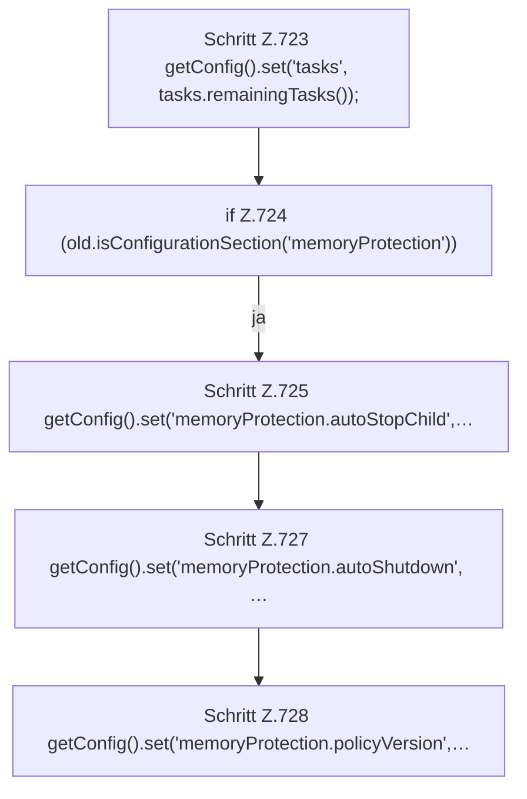

[[00 Start]] › [[Plugin-Kern]] › [[Setup]] › [[Setup-Import]] › [[FabricLauncherPlugin.importLegacyConfiguration]] › [[FabricLauncherPlugin.importLegacyConfiguration.Teil5]]

# FabricLauncherPlugin.importLegacyConfiguration.Teil5



```knoten
Schritt Z.723 getConfig().set('tasks', tasks.remainingTasks());
  Zeile 723: liest die Config. `getConfig().set('tasks', tasks.remainingTasks());`
if Z.724 (old.isConfigurationSection('memoryProtection'))
  Zeile 724: prüft `(old.isConfigurationSection('memoryProtection'))`.
Schritt Z.725 getConfig().set('memoryProtection.autoStopChild',…
  Zeile 725: liest die Config. `getConfig().set('memoryProtection.autoStopChild',…`
Schritt Z.727 getConfig().set('memoryProtection.autoShutdown', …
  Zeile 727: liest die Config. `getConfig().set('memoryProtection.autoShutdown', …`
Schritt Z.728 getConfig().set('memoryProtection.policyVersion',…
  Zeile 728: liest die Config. `getConfig().set('memoryProtection.policyVersion',…`
```

- Fortsetzung von `FabricLauncherPlugin.importLegacyConfiguration`, Quellreihenfolge.
