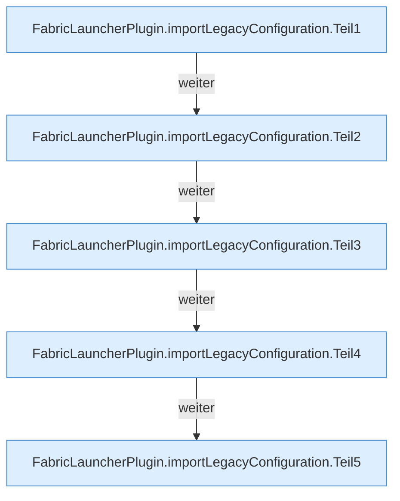

[[00 Start]] › [[Plugin-Kern]] › [[Setup]] › [[Setup-Import]] › [[FabricLauncherPlugin.importLegacyConfiguration]]

# FabricLauncherPlugin.importLegacyConfiguration

`FabricLauncherPlugin.importLegacyConfiguration(Path oldConfig, ServerProfile profile)` [src/main/java/de/aichele/childlauncher/FabricLauncherPlugin.java:679–730](https://github.com/Sciddie/minecraft-serverhoster-plugin/blob/95b02b953b0b4c23673e900e021a7c3c844aa37d/src/main/java/de/aichele/childlauncher/FabricLauncherPlugin.java#L679-L730)



```knoten
FabricLauncherPlugin.importLegacyConfiguration.Teil1
  Abschnitt 1 dieses Ablaufs, in Quellreihenfolge.
FabricLauncherPlugin.importLegacyConfiguration.Teil2
  Abschnitt 2 dieses Ablaufs, in Quellreihenfolge.
FabricLauncherPlugin.importLegacyConfiguration.Teil3
  Abschnitt 3 dieses Ablaufs, in Quellreihenfolge.
FabricLauncherPlugin.importLegacyConfiguration.Teil4
  Abschnitt 4 dieses Ablaufs, in Quellreihenfolge.
FabricLauncherPlugin.importLegacyConfiguration.Teil5
  Abschnitt 5 dieses Ablaufs, in Quellreihenfolge.
```

- `importLegacyConfiguration` in `src/main/java/de/aichele/childlauncher/FabricLauncherPlugin.java`
