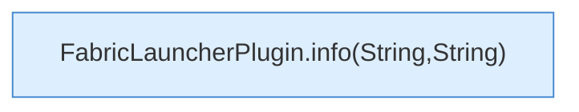

[[00 Start]] › [[Plugin-Kern]] › [[Slot-Aktionen]] › [[FabricLauncherPlugin.info(String)]]

# FabricLauncherPlugin.info(String)

`FabricLauncherPlugin.info(String m)` [src/main/java/de/aichele/childlauncher/FabricLauncherPlugin.java:338–338](https://github.com/Sciddie/minecraft-serverhoster-plugin/blob/95b02b953b0b4c23673e900e021a7c3c844aa37d/src/main/java/de/aichele/childlauncher/FabricLauncherPlugin.java#L338-L338)



```knoten
FabricLauncherPlugin.info(String,String)
  Schreibt eine Hinweiszeile in die [[Glossar#Konsole|Konsole]] des [[Glossar#Spielserver|Spielservers]]. Im [[Glossar#Quelltext|Quelltext]] heißt das `info(String,String)`.
```

> [!knoten]- Was die Blöcke tun
> - **FabricLauncherPlugin.info(String,String)**: Schreibt eine Hinweiszeile in die [[Glossar#Konsole|Konsole]] des [[Glossar#Spielserver|Spielservers]]. Im [[Glossar#Quelltext|Quelltext]] heißt das `info(String,String)`.

- Schreibt eine Hinweiszeile in die [[Glossar#Konsole|Konsole]] des [[Glossar#Spielserver|Spielservers]].
