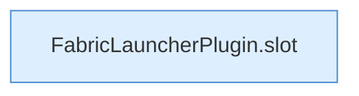

[[00 Start]] › [[Plugin-Kern]] › [[Slot-Aktionen]] › [[FabricLauncherPlugin.info(String,String)]]

# FabricLauncherPlugin.info(String,String)

`FabricLauncherPlugin.info(String id, String m)` [src/main/java/de/aichele/childlauncher/FabricLauncherPlugin.java:339–339](https://github.com/Sciddie/minecraft-serverhoster-plugin/blob/95b02b953b0b4c23673e900e021a7c3c844aa37d/src/main/java/de/aichele/childlauncher/FabricLauncherPlugin.java#L339-L339)

- `info` in `src/main/java/de/aichele/childlauncher/FabricLauncherPlugin.java`
