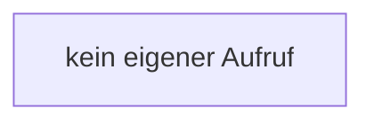

[[00 Start]] › [[Child-Prozess]] › [[Stopp]] › [[FabricLauncherPlugin.invalidateRestarts]]

# FabricLauncherPlugin.invalidateRestarts

`FabricLauncherPlugin.invalidateRestarts(ChildSlot slot)` [src/main/java/de/aichele/childlauncher/FabricLauncherPlugin.java:2021–2024](https://github.com/Sciddie/minecraft-serverhoster-plugin/blob/95b02b953b0b4c23673e900e021a7c3c844aa37d/src/main/java/de/aichele/childlauncher/FabricLauncherPlugin.java#L2021-L2024)



```knoten
kein eigener Aufruf
  Dieser Abschnitt ruft keine weitere eigene [[Glossar#Funktion|Funktion]] auf.
```

> [!knoten]- Was die Blöcke tun
> - **kein eigener Aufruf**: Dieser Abschnitt ruft keine weitere eigene [[Glossar#Funktion|Funktion]] auf.

- Vergisst geplante [[Glossar#Neustart|Neustarts]], damit ein absichtlicher [[Glossar#Stopp|Stopp]] nicht gleich wieder startet.
