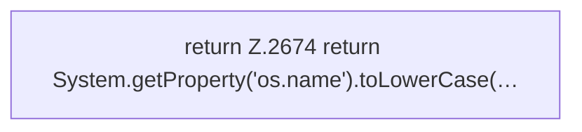

[[00 Start]] › [[Plugin-Kern]] › [[Host-Pfade]] › [[FabricLauncherPlugin.isWindows]]

# FabricLauncherPlugin.isWindows

`FabricLauncherPlugin.isWindows()` [src/main/java/de/aichele/childlauncher/FabricLauncherPlugin.java:2674–2674](https://github.com/Sciddie/minecraft-serverhoster-plugin/blob/95b02b953b0b4c23673e900e021a7c3c844aa37d/src/main/java/de/aichele/childlauncher/FabricLauncherPlugin.java#L2674-L2674)



```knoten
return Z.2674 return System.getProperty('os.name').toLowerCase(…
  Zeile 2674: Rückgabe `return System.getProperty('os.name').toLowerCase(…`.
```

- `isWindows` in `src/main/java/de/aichele/childlauncher/FabricLauncherPlugin.java`
