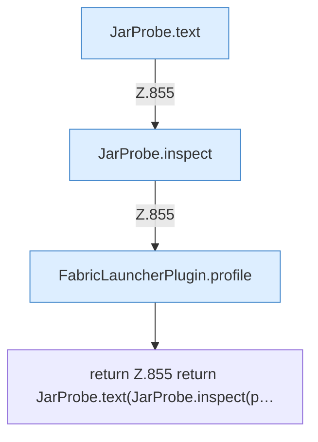

[[00 Start]] › [[Plugin-Kern]] › [[Diagnose]] › [[FabricLauncherPlugin.jarText]]

# FabricLauncherPlugin.jarText

`FabricLauncherPlugin.jarText(String id)` [src/main/java/de/aichele/childlauncher/FabricLauncherPlugin.java:855–855](https://github.com/Sciddie/minecraft-serverhoster-plugin/blob/95b02b953b0b4c23673e900e021a7c3c844aa37d/src/main/java/de/aichele/childlauncher/FabricLauncherPlugin.java#L855-L855)



```knoten
JarProbe.text
  Dieser Teil macht hier einen einzelnen Schritt. Eine Ebene tiefer steht er genauer. Im [[Glossar#Quelltext|Quelltext]] heißt das `text`.
JarProbe.inspect
  Dieser Teil macht hier einen einzelnen Schritt. Eine Ebene tiefer steht er genauer. Im [[Glossar#Quelltext|Quelltext]] heißt das `inspect`.
FabricLauncherPlugin.profile
  Das [[Glossar#Plugin|Plugin]] macht hier einen einzelnen Schritt. Eine Ebene tiefer steht er genauer. Im [[Glossar#Quelltext|Quelltext]] heißt das `profile`.
return Z.855 return JarProbe.text(JarProbe.inspect(p…
  Hier endet die [[Glossar#Funktion|Funktion]] und liefert ein Ergebnis zurück. Das steht in [[Glossar#Zeile|Zeile]] 855.
```

> [!knoten]- Was die Blöcke tun
> - **JarProbe.text**: Dieser Teil macht hier einen einzelnen Schritt. Eine Ebene tiefer steht er genauer. Im [[Glossar#Quelltext|Quelltext]] heißt das `text`.
> - **JarProbe.inspect**: Dieser Teil macht hier einen einzelnen Schritt. Eine Ebene tiefer steht er genauer. Im [[Glossar#Quelltext|Quelltext]] heißt das `inspect`.
> - **FabricLauncherPlugin.profile**: Das [[Glossar#Plugin|Plugin]] macht hier einen einzelnen Schritt. Eine Ebene tiefer steht er genauer. Im [[Glossar#Quelltext|Quelltext]] heißt das `profile`.
> - **return Z.855 return JarProbe.text(JarProbe.inspect(p…**: Hier endet die [[Glossar#Funktion|Funktion]] und liefert ein Ergebnis zurück. Das steht in [[Glossar#Zeile|Zeile]] 855.

- Zeigt Einzelheiten aus der [[Glossar#Programmdatei|Programmdatei]].
