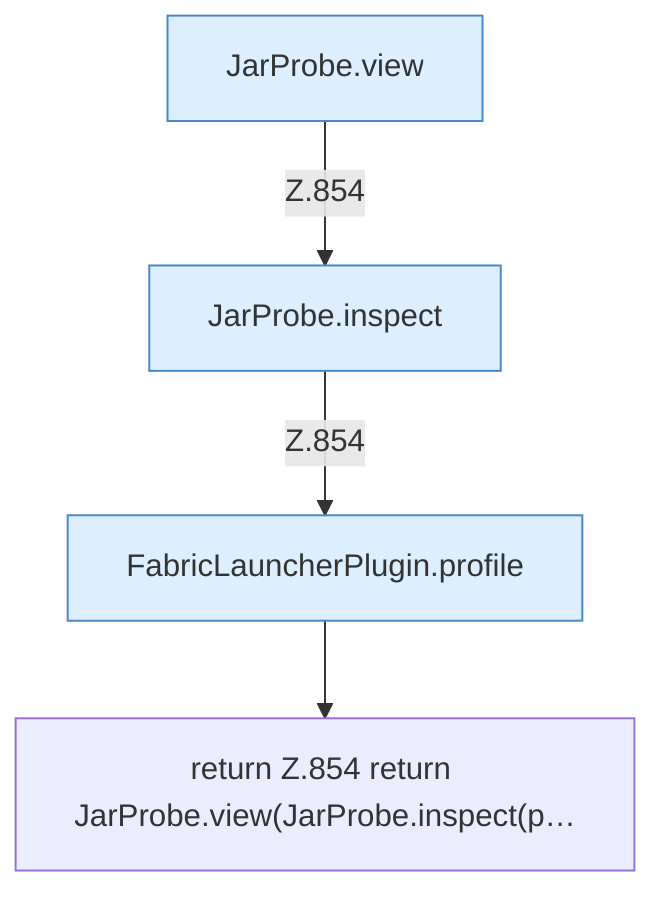

[[00 Start]] › [[Plugin-Kern]] › [[Diagnose]] › [[FabricLauncherPlugin.jarView]]

# FabricLauncherPlugin.jarView

`FabricLauncherPlugin.jarView(String id)` [src/main/java/de/aichele/childlauncher/FabricLauncherPlugin.java:854–854](https://github.com/Sciddie/minecraft-serverhoster-plugin/blob/95b02b953b0b4c23673e900e021a7c3c844aa37d/src/main/java/de/aichele/childlauncher/FabricLauncherPlugin.java#L854-L854)

- `jarView` in `src/main/java/de/aichele/childlauncher/FabricLauncherPlugin.java`
