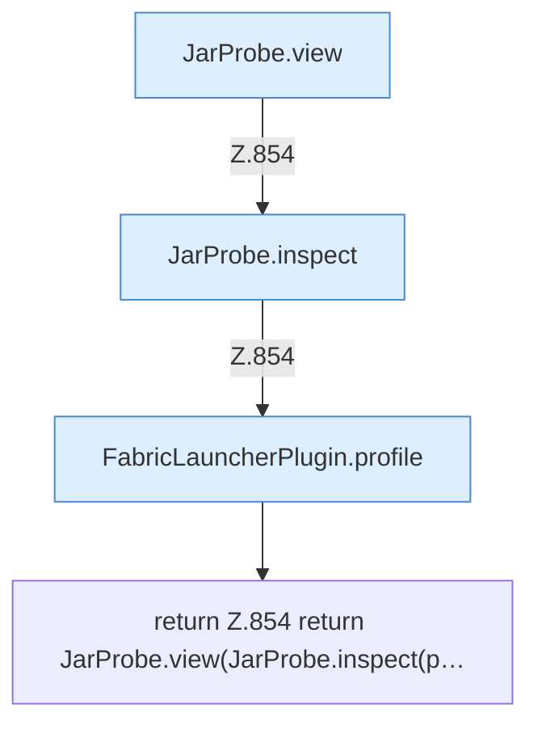

[[00 Start]] › [[Plugin-Kern]] › [[Diagnose]] › [[FabricLauncherPlugin.jarView]]

# FabricLauncherPlugin.jarView

`FabricLauncherPlugin.jarView(String id)` [src/main/java/de/aichele/childlauncher/FabricLauncherPlugin.java:854–854](https://github.com/Sciddie/minecraft-serverhoster-plugin/blob/95b02b953b0b4c23673e900e021a7c3c844aa37d/src/main/java/de/aichele/childlauncher/FabricLauncherPlugin.java#L854-L854)



```knoten
JarProbe.view
  Dieser Teil macht hier einen einzelnen Schritt. Eine Ebene tiefer steht er genauer. Im [[Glossar#Quelltext|Quelltext]] heißt das `view`.
JarProbe.inspect
  Dieser Teil macht hier einen einzelnen Schritt. Eine Ebene tiefer steht er genauer. Im [[Glossar#Quelltext|Quelltext]] heißt das `inspect`.
FabricLauncherPlugin.profile
  Das [[Glossar#Plugin|Plugin]] macht hier einen einzelnen Schritt. Eine Ebene tiefer steht er genauer. Im [[Glossar#Quelltext|Quelltext]] heißt das `profile`.
return Z.854 return JarProbe.view(JarProbe.inspect(p…
  Hier endet die [[Glossar#Funktion|Funktion]] und liefert ein Ergebnis zurück. Das steht in [[Glossar#Zeile|Zeile]] 854.
```

> [!knoten]- Was die Blöcke tun
> - **JarProbe.view**: Dieser Teil macht hier einen einzelnen Schritt. Eine Ebene tiefer steht er genauer. Im [[Glossar#Quelltext|Quelltext]] heißt das `view`.
> - **JarProbe.inspect**: Dieser Teil macht hier einen einzelnen Schritt. Eine Ebene tiefer steht er genauer. Im [[Glossar#Quelltext|Quelltext]] heißt das `inspect`.
> - **FabricLauncherPlugin.profile**: Das [[Glossar#Plugin|Plugin]] macht hier einen einzelnen Schritt. Eine Ebene tiefer steht er genauer. Im [[Glossar#Quelltext|Quelltext]] heißt das `profile`.
> - **return Z.854 return JarProbe.view(JarProbe.inspect(p…**: Hier endet die [[Glossar#Funktion|Funktion]] und liefert ein Ergebnis zurück. Das steht in [[Glossar#Zeile|Zeile]] 854.

- Zeigt, welche [[Glossar#Programmdatei|Programmdatei]] der [[Glossar#Spielserver|Spielserver]] benutzt.
