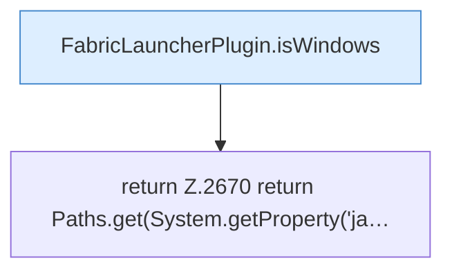

[[00 Start]] › [[Plugin-Kern]] › [[Host-Pfade]] › [[FabricLauncherPlugin.javaBin]]

# FabricLauncherPlugin.javaBin

`FabricLauncherPlugin.javaBin()` [src/main/java/de/aichele/childlauncher/FabricLauncherPlugin.java:2669–2671](https://github.com/Sciddie/minecraft-serverhoster-plugin/blob/95b02b953b0b4c23673e900e021a7c3c844aa37d/src/main/java/de/aichele/childlauncher/FabricLauncherPlugin.java#L2669-L2671)



```knoten
FabricLauncherPlugin.isWindows
  Das [[Glossar#Plugin|Plugin]] prüft Windows. Im [[Glossar#Quelltext|Quelltext]] heißt das `isWindows`.
return Z.2670 return Paths.get(System.getProperty('ja…
  Hier endet die [[Glossar#Funktion|Funktion]] und liefert ein Ergebnis zurück. Das steht in [[Glossar#Zeile|Zeile]] 2670.
```

> [!knoten]- Was die Blöcke tun
> - **FabricLauncherPlugin.isWindows**: Das [[Glossar#Plugin|Plugin]] prüft Windows. Im [[Glossar#Quelltext|Quelltext]] heißt das `isWindows`.
> - **return Z.2670 return Paths.get(System.getProperty('ja…**: Hier endet die [[Glossar#Funktion|Funktion]] und liefert ein Ergebnis zurück. Das steht in [[Glossar#Zeile|Zeile]] 2670.

- Liefert das Java-Programm, mit dem der [[Glossar#Spielserver|Spielserver]] gestartet wird.
