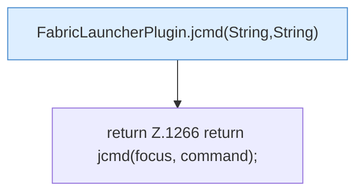

[[00 Start]] › [[Plugin-Kern]] › [[Diagnose]] › [[FabricLauncherPlugin.jcmd(String)]]

# FabricLauncherPlugin.jcmd(String)

`FabricLauncherPlugin.jcmd(String command)` [src/main/java/de/aichele/childlauncher/FabricLauncherPlugin.java:1266–1266](https://github.com/Sciddie/minecraft-serverhoster-plugin/blob/95b02b953b0b4c23673e900e021a7c3c844aa37d/src/main/java/de/aichele/childlauncher/FabricLauncherPlugin.java#L1266-L1266)

- `jcmd` in `src/main/java/de/aichele/childlauncher/FabricLauncherPlugin.java`
