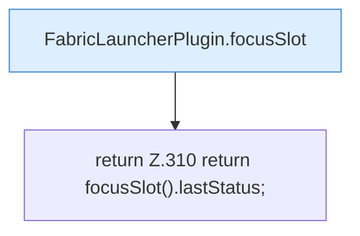

[[00 Start]] › [[Plugin-Kern]] › [[Slot-Status]] › [[FabricLauncherPlugin.lastStatus()]]

# FabricLauncherPlugin.lastStatus()

`FabricLauncherPlugin.lastStatus()` [src/main/java/de/aichele/childlauncher/FabricLauncherPlugin.java:310–310](https://github.com/Sciddie/minecraft-serverhoster-plugin/blob/95b02b953b0b4c23673e900e021a7c3c844aa37d/src/main/java/de/aichele/childlauncher/FabricLauncherPlugin.java#L310-L310)



```knoten
FabricLauncherPlugin.focusSlot
  Liefert oder setzt den Fokus `focusSlot`. Ruft `slot`.
return Z.310 return focusSlot().lastStatus;
  Zeile 310: Rückgabe `return focusSlot().lastStatus;`.
```

- `lastStatus` in `src/main/java/de/aichele/childlauncher/FabricLauncherPlugin.java`
- Befund: toter Code, sicher. src/main/java/de/aichele/childlauncher/FabricLauncherPlugin.java:310–310 kein Aufruf, kein Treffer in plugin.yml/UI/Strings
