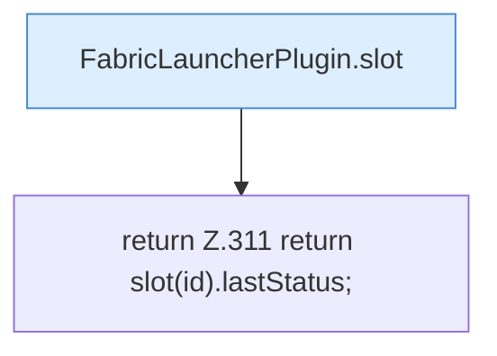

[[00 Start]] › [[Plugin-Kern]] › [[Slot-Status]] › [[FabricLauncherPlugin.lastStatus(String)]]

# FabricLauncherPlugin.lastStatus(String)

`FabricLauncherPlugin.lastStatus(String id)` [src/main/java/de/aichele/childlauncher/FabricLauncherPlugin.java:311–311](https://github.com/Sciddie/minecraft-serverhoster-plugin/blob/95b02b953b0b4c23673e900e021a7c3c844aa37d/src/main/java/de/aichele/childlauncher/FabricLauncherPlugin.java#L311-L311)



```knoten
FabricLauncherPlugin.slot
  `slot` in `FabricLauncherPlugin.java`. Ruft `profile`, `ChildSlot`.
return Z.311 return slot(id).lastStatus;
  Zeile 311: Rückgabe `return slot(id).lastStatus;`.
```

- `lastStatus` in `src/main/java/de/aichele/childlauncher/FabricLauncherPlugin.java`
- Befund: toter Code, sicher. src/main/java/de/aichele/childlauncher/FabricLauncherPlugin.java:311–311 kein Aufruf, kein Treffer in plugin.yml/UI/Strings
