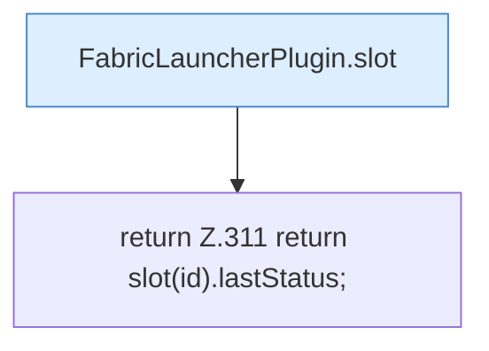

[[00 Start]] › [[Plugin-Kern]] › [[Slot-Status]] › [[FabricLauncherPlugin.lastStatus(String)]]

# FabricLauncherPlugin.lastStatus(String)

`FabricLauncherPlugin.lastStatus(String id)` [src/main/java/de/aichele/childlauncher/FabricLauncherPlugin.java:311–311](https://github.com/Sciddie/minecraft-serverhoster-plugin/blob/95b02b953b0b4c23673e900e021a7c3c844aa37d/src/main/java/de/aichele/childlauncher/FabricLauncherPlugin.java#L311-L311)



```knoten
FabricLauncherPlugin.slot
  Das [[Glossar#Plugin|Plugin]] macht hier einen einzelnen Schritt. Eine Ebene tiefer steht er genauer. Im [[Glossar#Quelltext|Quelltext]] heißt das `slot`.
return Z.311 return slot(id).lastStatus;
  Hier endet die [[Glossar#Funktion|Funktion]] und liefert ein Ergebnis zurück. Das steht in [[Glossar#Zeile|Zeile]] 311.
```

> [!knoten]- Was die Blöcke tun
> - **FabricLauncherPlugin.slot**: Das [[Glossar#Plugin|Plugin]] macht hier einen einzelnen Schritt. Eine Ebene tiefer steht er genauer. Im [[Glossar#Quelltext|Quelltext]] heißt das `slot`.
> - **return Z.311 return slot(id).lastStatus;**: Hier endet die [[Glossar#Funktion|Funktion]] und liefert ein Ergebnis zurück. Das steht in [[Glossar#Zeile|Zeile]] 311.

- Der letzte kurze Zustandstext, zum Beispiel startet oder läuft.
- Auffällig: im normalen Betrieb ruft das niemand auf. Das nennt man [[Glossar#Ungenutzt|Ungenutzt]].
