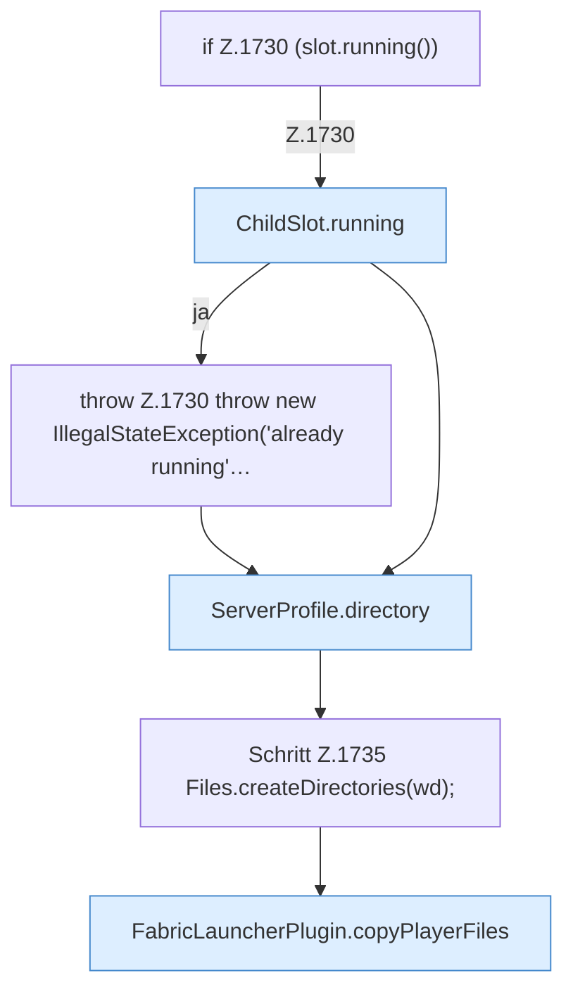

[[00 Start]] › [[Child-Prozess]] › [[Startablauf]] › [[FabricLauncherPlugin.launch]] › [[FabricLauncherPlugin.launch.Z1728.Z1728.Teil1]]

# FabricLauncherPlugin.launch.Z1728.Z1728.Teil1



```knoten
if Z.1730 (slot.running())
  Zeile 1730: prüft `(slot.running())`.
ChildSlot.running
  Dieser Teil prüft, ob läuft, das. Sagt, ob der [[Glossar#Prozess|Prozess]] läuft `running`.
throw Z.1730 throw new IllegalStateException('already running'…
  Zeile 1730: Abbruch `throw new IllegalStateException('already running'…`.
ServerProfile.directory
  Die Serverbeschreibung macht hier einen einzelnen Schritt. Eine Ebene tiefer steht er genauer. `directory` in `ServerProfile.java`.
Schritt Z.1735 Files.createDirectories(wd);
  Zeile 1735: Dateioperation. `Files.createDirectories(wd);`
FabricLauncherPlugin.copyPlayerFiles
  Das [[Glossar#Plugin|Plugin]] kopiert den [[Glossar#Spieler|Spieler]] die Dateien. Kopiert `copyPlayerFiles`.
```

> [!knoten]- Was die Blöcke tun
> - **if Z.1730 (slot.running())**: Zeile 1730: prüft `(slot.running())`.
> - **ChildSlot.running**: Dieser Teil prüft, ob läuft, das. Sagt, ob der [[Glossar#Prozess|Prozess]] läuft `running`.
> - **throw Z.1730 throw new IllegalStateException('already running'…**: Zeile 1730: Abbruch `throw new IllegalStateException('already running'…`.
> - **ServerProfile.directory**: Die Serverbeschreibung macht hier einen einzelnen Schritt. Eine Ebene tiefer steht er genauer. `directory` in `ServerProfile.java`.
> - **Schritt Z.1735 Files.createDirectories(wd);**: Zeile 1735: Dateioperation. `Files.createDirectories(wd);`
> - **FabricLauncherPlugin.copyPlayerFiles**: Das [[Glossar#Plugin|Plugin]] kopiert den [[Glossar#Spieler|Spieler]] die Dateien. Kopiert `copyPlayerFiles`.

- Ein weiterer Abschnitt derselben Übersicht.
- Fortsetzung von `FabricLauncherPlugin.launch.Z1728.Z1728`.
