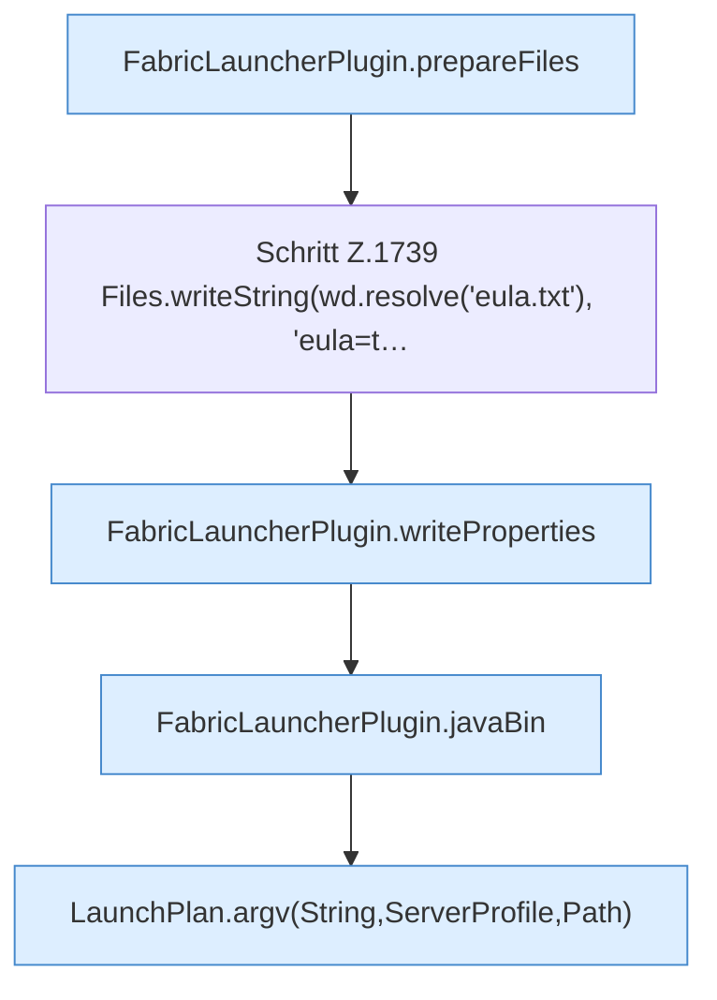

[[00 Start]] › [[Child-Prozess]] › [[Startablauf]] › [[FabricLauncherPlugin.launch]] › [[FabricLauncherPlugin.launch.Z1728.Z1728.Teil2]]

# FabricLauncherPlugin.launch.Z1728.Z1728.Teil2



```knoten
FabricLauncherPlugin.prepareFiles
  Das [[Glossar#Plugin|Plugin]] bereitet vor die Dateien. Bereitet vor `prepareFiles`. Ruft `firstStable`, `getJson`, `download`.
Schritt Z.1739 Files.writeString(wd.resolve('eula.txt'), 'eula=t…
  Zeile 1739: schreibt Text in eine Datei. `Files.writeString(wd.resolve('eula.txt'), 'eula=t…`
FabricLauncherPlugin.writeProperties
  Das [[Glossar#Plugin|Plugin]] schreibt die Eigenschaften. Schreibt `writeProperties`. Ruft `forcedProperties`, `hostBindAddress`, `updateProperties`.
FabricLauncherPlugin.javaBin
  Liefert das Java-Programm, mit dem der [[Glossar#Spielserver|Spielserver]] gestartet wird. Liefert das Java-Binary `javaBin`. Ruft `isWindows`.
LaunchPlan.argv(String,ServerProfile,Path)
  Dieser Teil macht hier einen einzelnen Schritt. Eine Ebene tiefer steht er genauer. `argv` in `LaunchPlan.java`.
```

> [!knoten]- Was die Blöcke tun
> - **FabricLauncherPlugin.prepareFiles**: Das [[Glossar#Plugin|Plugin]] bereitet vor die Dateien. Bereitet vor `prepareFiles`. Ruft `firstStable`, `getJson`, `download`.
> - **Schritt Z.1739 Files.writeString(wd.resolve('eula.txt'), 'eula=t…**: Zeile 1739: schreibt Text in eine Datei. `Files.writeString(wd.resolve('eula.txt'), 'eula=t…`
> - **FabricLauncherPlugin.writeProperties**: Das [[Glossar#Plugin|Plugin]] schreibt die Eigenschaften. Schreibt `writeProperties`. Ruft `forcedProperties`, `hostBindAddress`, `updateProperties`.
> - **FabricLauncherPlugin.javaBin**: Liefert das Java-Programm, mit dem der [[Glossar#Spielserver|Spielserver]] gestartet wird. Liefert das Java-Binary `javaBin`. Ruft `isWindows`.
> - **LaunchPlan.argv(String,ServerProfile,Path)**: Dieser Teil macht hier einen einzelnen Schritt. Eine Ebene tiefer steht er genauer. `argv` in `LaunchPlan.java`.

- Ein weiterer Abschnitt derselben Übersicht.
- Fortsetzung von `FabricLauncherPlugin.launch.Z1728.Z1728`.
