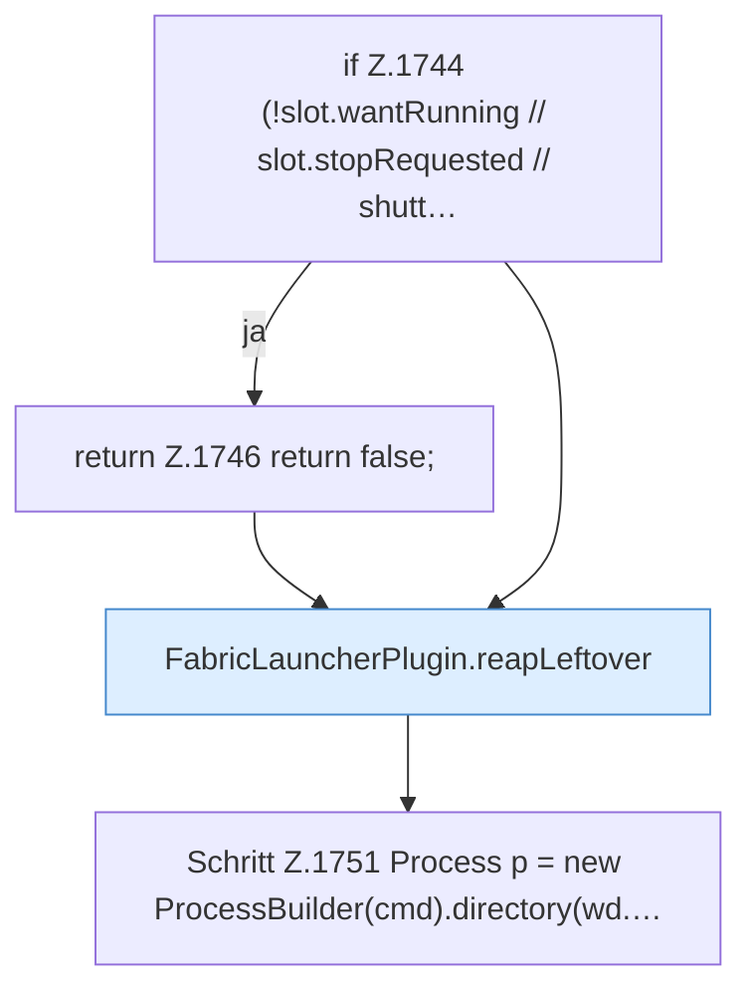

[[00 Start]] › [[Child-Prozess]] › [[Startablauf]] › [[FabricLauncherPlugin.launch]] › [[FabricLauncherPlugin.launch.Z1728.Z1728.Teil3]]

# FabricLauncherPlugin.launch.Z1728.Z1728.Teil3



```knoten
if Z.1744 (!slot.wantRunning // slot.stopRequested // shutt…
  Zeile 1744: prüft `(!slot.wantRunning // slot.stopRequested // shutt…`.
return Z.1746 return false;
  Zeile 1746: Rückgabe `return false;`.
FabricLauncherPlugin.reapLeftover
  Beendet ein Programm, das von einem früheren Start noch übrig ist. Räumt übrige [[Glossar#Prozess|Prozesse]] ab `reapLeftover`. Ruft `reap`, `processRecord`.
Schritt Z.1751 Process p = new ProcessBuilder(cmd).directory(wd.…
  Zeile 1751: baut einen Prozess. `Process p = new ProcessBuilder(cmd).directory(wd.…`
```

> [!knoten]- Was die Blöcke tun
> - **if Z.1744 (!slot.wantRunning // slot.stopRequested // shutt…**: Zeile 1744: prüft `(!slot.wantRunning // slot.stopRequested // shutt…`.
> - **return Z.1746 return false;**: Zeile 1746: Rückgabe `return false;`.
> - **FabricLauncherPlugin.reapLeftover**: Beendet ein Programm, das von einem früheren Start noch übrig ist. Räumt übrige [[Glossar#Prozess|Prozesse]] ab `reapLeftover`. Ruft `reap`, `processRecord`.
> - **Schritt Z.1751 Process p = new ProcessBuilder(cmd).directory(wd.…**: Zeile 1751: baut einen Prozess. `Process p = new ProcessBuilder(cmd).directory(wd.…`

- Ein weiterer Abschnitt derselben Übersicht.
- Fortsetzung von `FabricLauncherPlugin.launch.Z1728.Z1728`.
