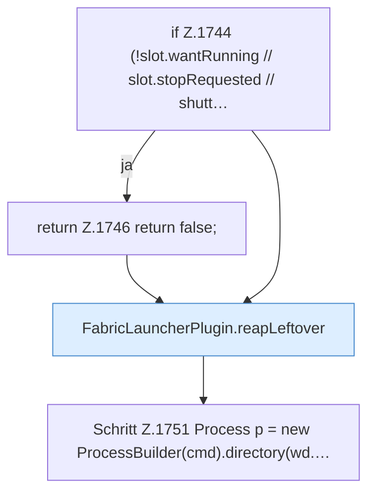

[[00 Start]] › [[Child-Prozess]] › [[Startablauf]] › [[FabricLauncherPlugin.launch]] › [[FabricLauncherPlugin.launch.Z1728.Z1728.Teil3]]

# FabricLauncherPlugin.launch.Z1728.Z1728.Teil3

- Fortsetzung von `FabricLauncherPlugin.launch.Z1728.Z1728`, Quellreihenfolge.
