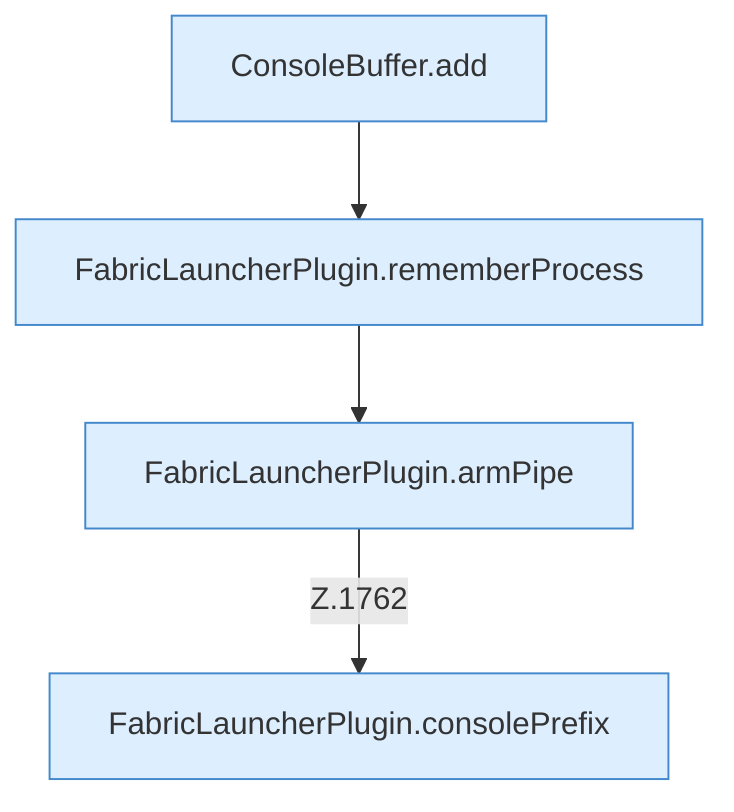

[[00 Start]] › [[Child-Prozess]] › [[Startablauf]] › [[FabricLauncherPlugin.launch]] › [[FabricLauncherPlugin.launch.Z1728.Z1728.Teil4]]

# FabricLauncherPlugin.launch.Z1728.Z1728.Teil4



```knoten
ConsoleBuffer.add
  Dieser Teil fügt hinzu das. Fügt hinzu `add`.
FabricLauncherPlugin.rememberProcess
  Merkt sich Programmnummer und [[Glossar#Programmdatei|Programmdatei]], damit das [[Glossar#Plugin|Plugin]] den [[Glossar#Spielserver|Spielserver]] später wiederfindet. Merkt sich den [[Glossar#Prozess|Prozess]] `rememberProcess`. Ruft `write`, `processRecord`, `directory`.
FabricLauncherPlugin.armPipe
  Schaltet das Mitlesen der [[Glossar#Konsole|Konsole]] an. Hängt die Überwachung an `armPipe`. Ruft `pipe`.
FabricLauncherPlugin.consolePrefix
  Setzt eine kurze Kennung vor jede [[Glossar#Zeile|Zeile]], damit man sie dem [[Glossar#Spielserver|Spielserver]] zuordnen kann. Liefert die [[Glossar#Konsole|Konsole]] `consolePrefix`.
```

> [!knoten]- Was die Blöcke tun
> - **ConsoleBuffer.add**: Dieser Teil fügt hinzu das. Fügt hinzu `add`.
> - **FabricLauncherPlugin.rememberProcess**: Merkt sich Programmnummer und [[Glossar#Programmdatei|Programmdatei]], damit das [[Glossar#Plugin|Plugin]] den [[Glossar#Spielserver|Spielserver]] später wiederfindet. Merkt sich den [[Glossar#Prozess|Prozess]] `rememberProcess`. Ruft `write`, `processRecord`, `directory`.
> - **FabricLauncherPlugin.armPipe**: Schaltet das Mitlesen der [[Glossar#Konsole|Konsole]] an. Hängt die Überwachung an `armPipe`. Ruft `pipe`.
> - **FabricLauncherPlugin.consolePrefix**: Setzt eine kurze Kennung vor jede [[Glossar#Zeile|Zeile]], damit man sie dem [[Glossar#Spielserver|Spielserver]] zuordnen kann. Liefert die [[Glossar#Konsole|Konsole]] `consolePrefix`.

- Ein weiterer Abschnitt derselben Übersicht.
- Fortsetzung von `FabricLauncherPlugin.launch.Z1728.Z1728`.
