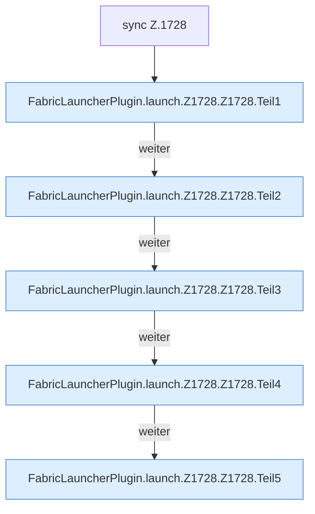

[[00 Start]] › [[Child-Prozess]] › [[Startablauf]] › [[FabricLauncherPlugin.launch]] › [[FabricLauncherPlugin.launch.Z1728.Z1728]]

# FabricLauncherPlugin.launch.Z1728.Z1728



```knoten
sync Z.1728
  Zeile 1728: synchronisierter Block.
FabricLauncherPlugin.launch.Z1728.Z1728.Teil1
  Ein weiterer Abschnitt derselben Übersicht. Abschnitt 1 dieses Ablaufs, in Quellreihenfolge.
FabricLauncherPlugin.launch.Z1728.Z1728.Teil2
  Ein weiterer Abschnitt derselben Übersicht. Abschnitt 2 dieses Ablaufs, in Quellreihenfolge.
FabricLauncherPlugin.launch.Z1728.Z1728.Teil3
  Ein weiterer Abschnitt derselben Übersicht. Abschnitt 3 dieses Ablaufs, in Quellreihenfolge.
FabricLauncherPlugin.launch.Z1728.Z1728.Teil4
  Ein weiterer Abschnitt derselben Übersicht. Abschnitt 4 dieses Ablaufs, in Quellreihenfolge.
FabricLauncherPlugin.launch.Z1728.Z1728.Teil5
  Ein weiterer Abschnitt derselben Übersicht. Abschnitt 5 dieses Ablaufs, in Quellreihenfolge.
```

> [!knoten]- Was die Blöcke tun
> - **sync Z.1728**: Zeile 1728: synchronisierter Block.
> - **FabricLauncherPlugin.launch.Z1728.Z1728.Teil1**: Ein weiterer Abschnitt derselben Übersicht. Abschnitt 1 dieses Ablaufs, in Quellreihenfolge.
> - **FabricLauncherPlugin.launch.Z1728.Z1728.Teil2**: Ein weiterer Abschnitt derselben Übersicht. Abschnitt 2 dieses Ablaufs, in Quellreihenfolge.
> - **FabricLauncherPlugin.launch.Z1728.Z1728.Teil3**: Ein weiterer Abschnitt derselben Übersicht. Abschnitt 3 dieses Ablaufs, in Quellreihenfolge.
> - **FabricLauncherPlugin.launch.Z1728.Z1728.Teil4**: Ein weiterer Abschnitt derselben Übersicht. Abschnitt 4 dieses Ablaufs, in Quellreihenfolge.
> - **FabricLauncherPlugin.launch.Z1728.Z1728.Teil5**: Ein weiterer Abschnitt derselben Übersicht. Abschnitt 5 dieses Ablaufs, in Quellreihenfolge.

- Der Ablauf geht in [[Glossar#Zeile|Zeile]] 1728 weiter. Eine Ebene tiefer steht er genauer.
- Fortsetzung von `FabricLauncherPlugin.launch.Z1728`.
