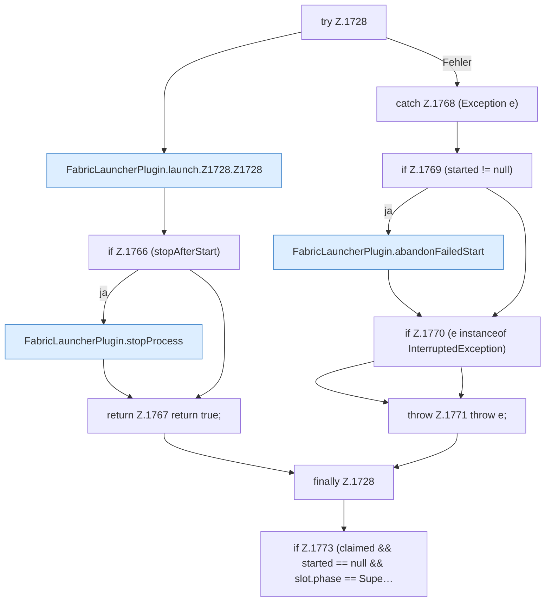

[[00 Start]] › [[Child-Prozess]] › [[Startablauf]] › [[FabricLauncherPlugin.launch]] › [[FabricLauncherPlugin.launch.Z1728]]

# FabricLauncherPlugin.launch.Z1728



```knoten
try Z.1728
  Zeile 1728: Versuch. Der Fehlerpfad geht in catch.
FabricLauncherPlugin.launch.Z1728.Z1728
  Der Ablauf geht in [[Glossar#Zeile|Zeile]] 1728 weiter. Eine Ebene tiefer steht er genauer. Fortsetzung des Ablaufs ab Zeile 1728.
if Z.1766 (stopAfterStart)
  Zeile 1766: prüft `(stopAfterStart)`.
FabricLauncherPlugin.stopProcess
  Fährt den [[Glossar#Spielserver|Spielserver]] herunter: erst die Bitte, dann Warten, dann ein hartes Beenden. Stoppt `stopProcess`. Ruft `add`, `boundedSeconds`, `warnOnce`.
return Z.1767 return true;
  Zeile 1767: Rückgabe `return true;`.
catch Z.1768 (Exception e)
  Zeile 1768: fängt (Exception e).
if Z.1769 (started != null)
  Zeile 1769: prüft `(started != null)`.
FabricLauncherPlugin.abandonFailedStart
  Bricht einen Start ab, der nicht geklappt hat, und setzt den Zustand zurück auf aus. Bricht den fehlgeschlagenen Start ab `abandonFailedStart`. Ruft `abandon`, `deleteIfMatch`, `processRecord`.
if Z.1770 (e instanceof InterruptedException)
  Zeile 1770: prüft `(e instanceof InterruptedException)`.
throw Z.1771 throw e;
  Zeile 1771: Abbruch `throw e;`.
finally Z.1728
  Läuft danach immer, auch nach einem Fehler.
if Z.1773 (claimed && started == null && slot.phase == Supe…
  Zeile 1773: prüft `(claimed && started == null && slot.phase == Supe…`.
```

> [!knoten]- Was die Blöcke tun
> - **try Z.1728**: Zeile 1728: Versuch. Der Fehlerpfad geht in catch.
> - **FabricLauncherPlugin.launch.Z1728.Z1728**: Der Ablauf geht in [[Glossar#Zeile|Zeile]] 1728 weiter. Eine Ebene tiefer steht er genauer. Fortsetzung des Ablaufs ab Zeile 1728.
> - **if Z.1766 (stopAfterStart)**: Zeile 1766: prüft `(stopAfterStart)`.
> - **FabricLauncherPlugin.stopProcess**: Fährt den [[Glossar#Spielserver|Spielserver]] herunter: erst die Bitte, dann Warten, dann ein hartes Beenden. Stoppt `stopProcess`. Ruft `add`, `boundedSeconds`, `warnOnce`.
> - **return Z.1767 return true;**: Zeile 1767: Rückgabe `return true;`.
> - **catch Z.1768 (Exception e)**: Zeile 1768: fängt (Exception e).
> - **if Z.1769 (started != null)**: Zeile 1769: prüft `(started != null)`.
> - **FabricLauncherPlugin.abandonFailedStart**: Bricht einen Start ab, der nicht geklappt hat, und setzt den Zustand zurück auf aus. Bricht den fehlgeschlagenen Start ab `abandonFailedStart`. Ruft `abandon`, `deleteIfMatch`, `processRecord`.
> - **if Z.1770 (e instanceof InterruptedException)**: Zeile 1770: prüft `(e instanceof InterruptedException)`.
> - **throw Z.1771 throw e;**: Zeile 1771: Abbruch `throw e;`.
> - **finally Z.1728**: Läuft danach immer, auch nach einem Fehler.
> - **if Z.1773 (claimed && started == null && slot.phase == Supe…**: Zeile 1773: prüft `(claimed && started == null && slot.phase == Supe…`.

- Der Ablauf geht in [[Glossar#Zeile|Zeile]] 1728 weiter. Eine Ebene tiefer steht er genauer.
- Fortsetzung von `FabricLauncherPlugin.launch`.
