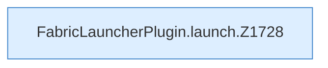

[[00 Start]] › [[Child-Prozess]] › [[Startablauf]] › [[FabricLauncherPlugin.launch]]

# FabricLauncherPlugin.launch

`FabricLauncherPlugin.launch(ServerProfile profile, ChildSlot slot)` [src/main/java/de/aichele/childlauncher/FabricLauncherPlugin.java:1724–1775](https://github.com/Sciddie/minecraft-serverhoster-plugin/blob/95b02b953b0b4c23673e900e021a7c3c844aa37d/src/main/java/de/aichele/childlauncher/FabricLauncherPlugin.java#L1724-L1775)



```knoten
FabricLauncherPlugin.launch.Z1728
  Fortsetzung des Ablaufs ab Zeile 1728.
```

- `launch` in `src/main/java/de/aichele/childlauncher/FabricLauncherPlugin.java`
