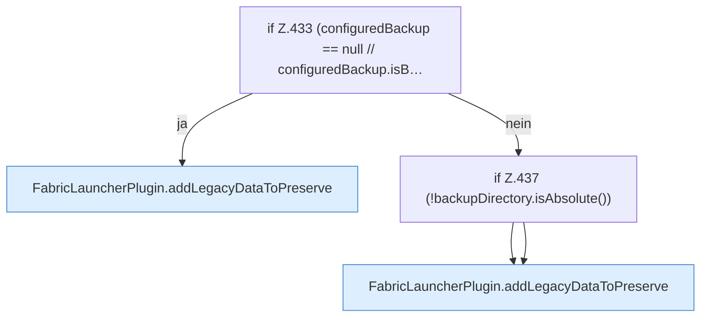

[[00 Start]] › [[Plugin-Kern]] › [[Setup]] › [[Setup-Aufraeumen]] › [[FabricLauncherPlugin.legacyDataToPreserve]] › [[FabricLauncherPlugin.legacyDataToPreserve.Z433]]

# FabricLauncherPlugin.legacyDataToPreserve.Z433



```knoten
if Z.433 (configuredBackup == null // configuredBackup.isB…
  Zeile 433: prüft `(configuredBackup == null // configuredBackup.isB…`.
FabricLauncherPlugin.addLegacyDataToPreserve
  Fügt hinzu `addLegacyDataToPreserve`.
if Z.437 (!backupDirectory.isAbsolute())
  Zeile 437: prüft `(!backupDirectory.isAbsolute())`.
```

- Fortsetzung von `FabricLauncherPlugin.legacyDataToPreserve`, Quellreihenfolge.
