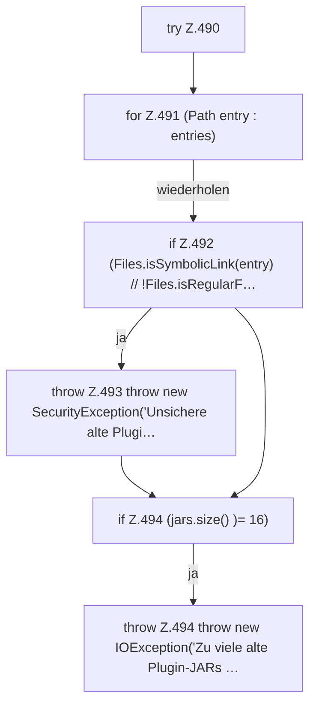

[[00 Start]] › [[Plugin-Kern]] › [[Setup]] › [[Setup-Aufraeumen]] › [[FabricLauncherPlugin.legacyJarNames]] › [[FabricLauncherPlugin.legacyJarNames.Z490]]

# FabricLauncherPlugin.legacyJarNames.Z490



```knoten
try Z.490
  Zeile 490: Versuch. Der Fehlerpfad geht in catch.
for Z.491 (Path entry : entries)
  Zeile 491: Schleife `(Path entry : entries)`.
if Z.492 (Files.isSymbolicLink(entry) // !Files.isRegularF…
  Zeile 492: prüft `(Files.isSymbolicLink(entry) // !Files.isRegularF…`.
throw Z.493 throw new SecurityException('Unsichere alte Plugi…
  Zeile 493: Abbruch `throw new SecurityException('Unsichere alte Plugi…`.
if Z.494 (jars.size() )= 16)
  Zeile 494: prüft `(jars.size() )= 16)`.
throw Z.494 throw new IOException('Zu viele alte Plugin-JARs …
  Zeile 494: Abbruch `throw new IOException('Zu viele alte Plugin-JARs …`.
```

- Fortsetzung von `FabricLauncherPlugin.legacyJarNames`, Quellreihenfolge.
