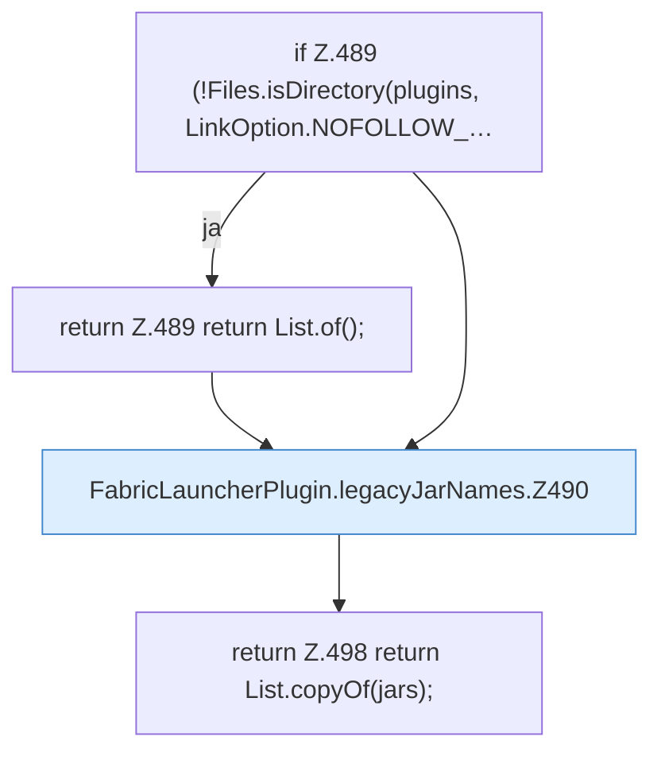

[[00 Start]] › [[Plugin-Kern]] › [[Setup]] › [[Setup-Aufraeumen]] › [[FabricLauncherPlugin.legacyJarNames]]

# FabricLauncherPlugin.legacyJarNames

`FabricLauncherPlugin.legacyJarNames(Path plugins)` [src/main/java/de/aichele/childlauncher/FabricLauncherPlugin.java:487–499](https://github.com/Sciddie/minecraft-serverhoster-plugin/blob/95b02b953b0b4c23673e900e021a7c3c844aa37d/src/main/java/de/aichele/childlauncher/FabricLauncherPlugin.java#L487-L499)



```knoten
if Z.489 (!Files.isDirectory(plugins, LinkOption.NOFOLLOW_…
  Zeile 489: prüft `(!Files.isDirectory(plugins, LinkOption.NOFOLLOW_…`.
return Z.489 return List.of();
  Zeile 489: Rückgabe `return List.of();`.
FabricLauncherPlugin.legacyJarNames.Z490
  Der Ablauf geht in [[Glossar#Zeile|Zeile]] 490 weiter. Eine Ebene tiefer steht er genauer. Fortsetzung des Ablaufs ab Zeile 490.
return Z.498 return List.copyOf(jars);
  Zeile 498: Rückgabe `return List.copyOf(jars);`.
```

> [!knoten]- Was die Blöcke tun
> - **if Z.489 (!Files.isDirectory(plugins, LinkOption.NOFOLLOW_…**: Zeile 489: prüft `(!Files.isDirectory(plugins, LinkOption.NOFOLLOW_…`.
> - **return Z.489 return List.of();**: Zeile 489: Rückgabe `return List.of();`.
> - **FabricLauncherPlugin.legacyJarNames.Z490**: Der Ablauf geht in [[Glossar#Zeile|Zeile]] 490 weiter. Eine Ebene tiefer steht er genauer. Fortsetzung des Ablaufs ab Zeile 490.
> - **return Z.498 return List.copyOf(jars);**: Zeile 498: Rückgabe `return List.copyOf(jars);`.

- Das [[Glossar#Plugin|Plugin]] kümmert sich um die [[Glossar#Programmdatei|Programmdatei]] die Namen.
- `legacyJarNames` in `src/main/java/de/aichele/childlauncher/FabricLauncherPlugin.java`
