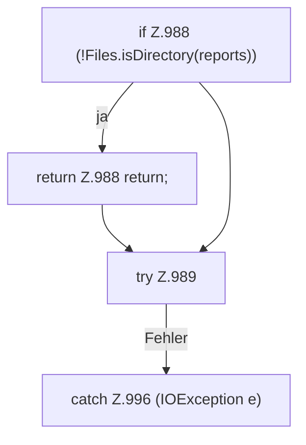

[[00 Start]] › [[Host-Betrieb]] › [[Speicher-Stopp]] › [[FabricLauncherPlugin.loadLatestMemoryIncidentReport]]

# FabricLauncherPlugin.loadLatestMemoryIncidentReport

`FabricLauncherPlugin.loadLatestMemoryIncidentReport()` [src/main/java/de/aichele/childlauncher/FabricLauncherPlugin.java:986–999](https://github.com/Sciddie/minecraft-serverhoster-plugin/blob/95b02b953b0b4c23673e900e021a7c3c844aa37d/src/main/java/de/aichele/childlauncher/FabricLauncherPlugin.java#L986-L999)



```knoten
if Z.988 (!Files.isDirectory(reports))
  Zeile 988: prüft `(!Files.isDirectory(reports))`.
return Z.988 return;
  Zeile 988: Rückgabe `return;`.
try Z.989
  Zeile 989: Versuch. Der Fehlerpfad geht in catch.
catch Z.996 (IOException e)
  Zeile 996: fängt (IOException e).
```

- `loadLatestMemoryIncidentReport` in `src/main/java/de/aichele/childlauncher/FabricLauncherPlugin.java`
