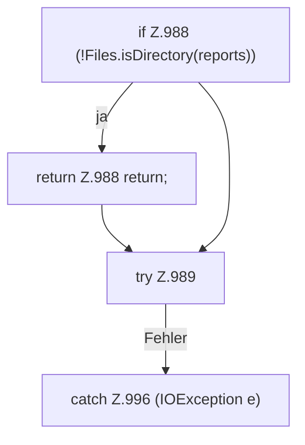

[[00 Start]] › [[Host-Betrieb]] › [[Speicher-Stopp]] › [[FabricLauncherPlugin.loadLatestMemoryIncidentReport]]

# FabricLauncherPlugin.loadLatestMemoryIncidentReport

`FabricLauncherPlugin.loadLatestMemoryIncidentReport()` [src/main/java/de/aichele/childlauncher/FabricLauncherPlugin.java:986–999](https://github.com/Sciddie/minecraft-serverhoster-plugin/blob/95b02b953b0b4c23673e900e021a7c3c844aa37d/src/main/java/de/aichele/childlauncher/FabricLauncherPlugin.java#L986-L999)



```knoten
if Z.988 (!Files.isDirectory(reports))
  Hier fällt eine Entscheidung. Nur wenn sie zutrifft, geht es den Ja-Weg weiter. Das steht in [[Glossar#Zeile|Zeile]] 988.
return Z.988 return;
  Hier endet die [[Glossar#Funktion|Funktion]] und liefert ein Ergebnis zurück. Das steht in [[Glossar#Zeile|Zeile]] 988.
try Z.989
  Das Programm versucht diesen Schritt. Geht er schief, führt der andere Weg weiter. Das steht in [[Glossar#Zeile|Zeile]] 989.
catch Z.996 (IOException e)
  Dieser Weg gilt, wenn der Schritt davor schiefgegangen ist. Das steht in [[Glossar#Zeile|Zeile]] 996.
```

> [!knoten]- Was die Blöcke tun
> - **if Z.988 (!Files.isDirectory(reports))**: Hier fällt eine Entscheidung. Nur wenn sie zutrifft, geht es den Ja-Weg weiter. Das steht in [[Glossar#Zeile|Zeile]] 988.
> - **return Z.988 return;**: Hier endet die [[Glossar#Funktion|Funktion]] und liefert ein Ergebnis zurück. Das steht in [[Glossar#Zeile|Zeile]] 988.
> - **try Z.989**: Das Programm versucht diesen Schritt. Geht er schief, führt der andere Weg weiter. Das steht in [[Glossar#Zeile|Zeile]] 989.
> - **catch Z.996 (IOException e)**: Dieser Weg gilt, wenn der Schritt davor schiefgegangen ist. Das steht in [[Glossar#Zeile|Zeile]] 996.

- Das [[Glossar#Plugin|Plugin]] lädt den letzten Stand den [[Glossar#Arbeitsspeicher|Arbeitsspeicher]] den [[Glossar#Vorfall|Vorfall]] den Bericht.
