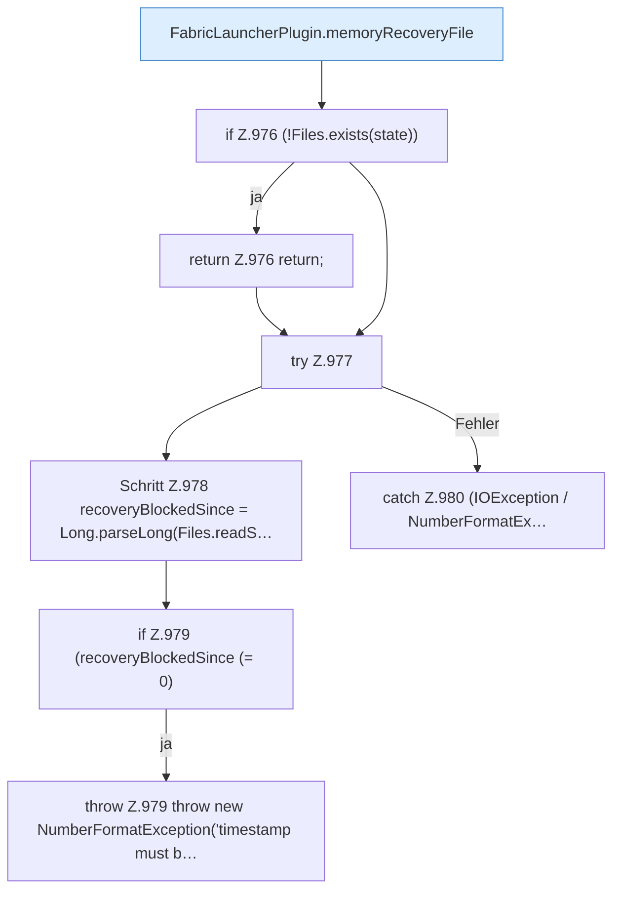

[[00 Start]] › [[Host-Betrieb]] › [[Speicher-Stopp]] › [[FabricLauncherPlugin.loadMemoryRecoveryState]]

# FabricLauncherPlugin.loadMemoryRecoveryState

`FabricLauncherPlugin.loadMemoryRecoveryState()` [src/main/java/de/aichele/childlauncher/FabricLauncherPlugin.java:974–984](https://github.com/Sciddie/minecraft-serverhoster-plugin/blob/95b02b953b0b4c23673e900e021a7c3c844aa37d/src/main/java/de/aichele/childlauncher/FabricLauncherPlugin.java#L974-L984)



```knoten
FabricLauncherPlugin.memoryRecoveryFile
  Die Datei, in der steht, ob der Speicher nach einem [[Glossar#Vorfall|Vorfall]] schon wieder freigegeben wurde. Im [[Glossar#Quelltext|Quelltext]] heißt das `memoryRecoveryFile`.
if Z.976 (!Files.exists(state))
  Hier fällt eine Entscheidung. Nur wenn sie zutrifft, geht es den Ja-Weg weiter. Das steht in [[Glossar#Zeile|Zeile]] 976.
return Z.976 return;
  Hier endet die [[Glossar#Funktion|Funktion]] und liefert ein Ergebnis zurück. Das steht in [[Glossar#Zeile|Zeile]] 976.
try Z.977
  Das Programm versucht diesen Schritt. Geht er schief, führt der andere Weg weiter. Das steht in [[Glossar#Zeile|Zeile]] 977.
Schritt Z.978 recoveryBlockedSince = Long.parseLong(Files.readS…
  Ein einzelner Arbeitsschritt, ohne eine weitere eigene [[Glossar#Funktion|Funktion]] aufzurufen. Das steht in [[Glossar#Zeile|Zeile]] 978.
if Z.979 (recoveryBlockedSince (= 0)
  Hier fällt eine Entscheidung. Nur wenn sie zutrifft, geht es den Ja-Weg weiter. Das steht in [[Glossar#Zeile|Zeile]] 979.
throw Z.979 throw new NumberFormatException('timestamp must b…
  Hier bricht die [[Glossar#Funktion|Funktion]] ab, weil etwas nicht geklappt hat. Das steht in [[Glossar#Zeile|Zeile]] 979.
catch Z.980 (IOException / NumberFormatEx…
  Dieser Weg gilt, wenn der Schritt davor schiefgegangen ist. Das steht in [[Glossar#Zeile|Zeile]] 980.
```

> [!knoten]- Was die Blöcke tun
> - **FabricLauncherPlugin.memoryRecoveryFile**: Die Datei, in der steht, ob der Speicher nach einem [[Glossar#Vorfall|Vorfall]] schon wieder freigegeben wurde. Im [[Glossar#Quelltext|Quelltext]] heißt das `memoryRecoveryFile`.
> - **if Z.976 (!Files.exists(state))**: Hier fällt eine Entscheidung. Nur wenn sie zutrifft, geht es den Ja-Weg weiter. Das steht in [[Glossar#Zeile|Zeile]] 976.
> - **return Z.976 return;**: Hier endet die [[Glossar#Funktion|Funktion]] und liefert ein Ergebnis zurück. Das steht in [[Glossar#Zeile|Zeile]] 976.
> - **try Z.977**: Das Programm versucht diesen Schritt. Geht er schief, führt der andere Weg weiter. Das steht in [[Glossar#Zeile|Zeile]] 977.
> - **Schritt Z.978 recoveryBlockedSince = Long.parseLong(Files.readS…**: Ein einzelner Arbeitsschritt, ohne eine weitere eigene [[Glossar#Funktion|Funktion]] aufzurufen. Das steht in [[Glossar#Zeile|Zeile]] 978.
> - **if Z.979 (recoveryBlockedSince (= 0)**: Hier fällt eine Entscheidung. Nur wenn sie zutrifft, geht es den Ja-Weg weiter. Das steht in [[Glossar#Zeile|Zeile]] 979.
> - **throw Z.979 throw new NumberFormatException('timestamp must b…**: Hier bricht die [[Glossar#Funktion|Funktion]] ab, weil etwas nicht geklappt hat. Das steht in [[Glossar#Zeile|Zeile]] 979.
> - **catch Z.980 (IOException / NumberFormatEx…**: Dieser Weg gilt, wenn der Schritt davor schiefgegangen ist. Das steht in [[Glossar#Zeile|Zeile]] 980.

- Das [[Glossar#Plugin|Plugin]] lädt den [[Glossar#Arbeitsspeicher|Arbeitsspeicher]] die Wiederherstellung den Zustand.
