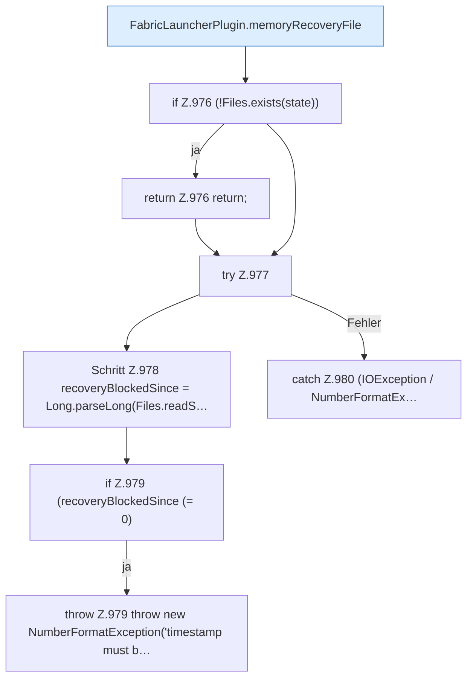

[[00 Start]] › [[Host-Betrieb]] › [[Speicher-Stopp]] › [[FabricLauncherPlugin.loadMemoryRecoveryState]]

# FabricLauncherPlugin.loadMemoryRecoveryState

`FabricLauncherPlugin.loadMemoryRecoveryState()` [src/main/java/de/aichele/childlauncher/FabricLauncherPlugin.java:974–984](https://github.com/Sciddie/minecraft-serverhoster-plugin/blob/95b02b953b0b4c23673e900e021a7c3c844aa37d/src/main/java/de/aichele/childlauncher/FabricLauncherPlugin.java#L974-L984)

- `loadMemoryRecoveryState` in `src/main/java/de/aichele/childlauncher/FabricLauncherPlugin.java`
