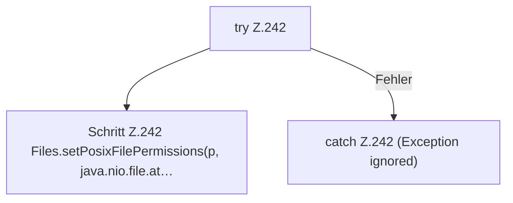

[[00 Start]] › [[Plugin-Kern]] › [[Lebenszyklus]] › [[FabricLauncherPlugin.makeWritable]]

# FabricLauncherPlugin.makeWritable

`FabricLauncherPlugin.makeWritable(Path p, boolean dir)` [src/main/java/de/aichele/childlauncher/FabricLauncherPlugin.java:241–243](https://github.com/Sciddie/minecraft-serverhoster-plugin/blob/95b02b953b0b4c23673e900e021a7c3c844aa37d/src/main/java/de/aichele/childlauncher/FabricLauncherPlugin.java#L241-L243)

- Setzt POSIX `rwxrwxrwx` für Ordner und `rw-rw-rw-` für Dateien.
- Befund: Logikrisiko, sicher. FabricLauncherPlugin.java:241–242 rwxrwxrwx und rw-rw-rw-. Kommentar Z.240 sagt rw für group/other
